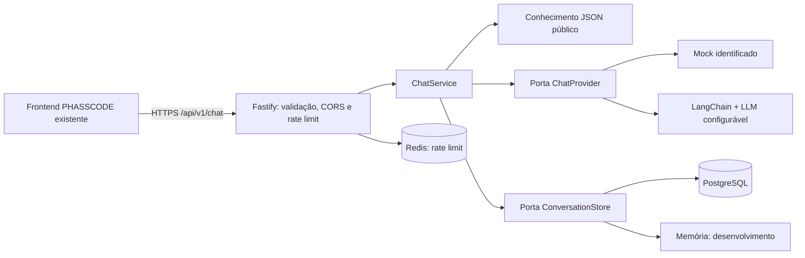
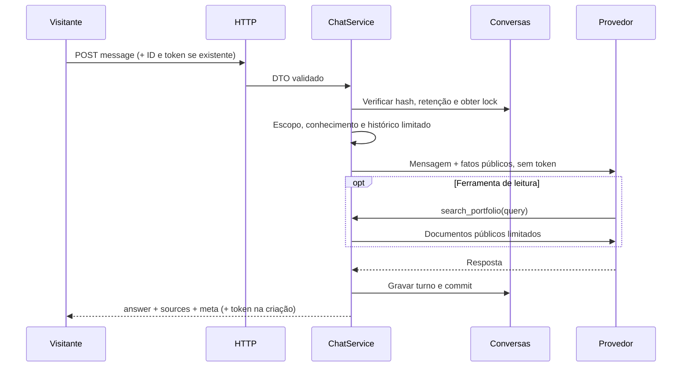

# Diagramas

## Incremento executável

## Chat e privacidade

## Reuniões: Fase 3 implementada

```mermaid
stateDiagram-v2
  [*] --> PENDING: solicitação validada
  PENDING --> APPROVED: administrador aprova
  PENDING --> REJECTED: administrador recusa
  PENDING --> CANCELLED: cancelamento autorizado
  APPROVED --> CONFIRMED: revalidação e criação Calendar verificadas
  APPROVED --> FAILED: conflito ou falha externa final
  APPROVED --> CANCELLED: antes da confirmação
  FAILED --> APPROVED: retry administrativo idempotente
  FAILED --> CANCELLED: desistência
  CONFIRMED --> CANCELLED: decisão administrativa; cleanup externo pendente
```

`APPROVED` é autorização interna; `CONFIRMED` exige evento externo verificado. `CANCELLED` é a
decisão administrativa; a reserva permanece até o worker verificar a remoção externa. Falha
ambígua também preserva a reserva. Detalhes, outbox e diagrama do fluxo estão em
[meetings.md](meetings.md).
