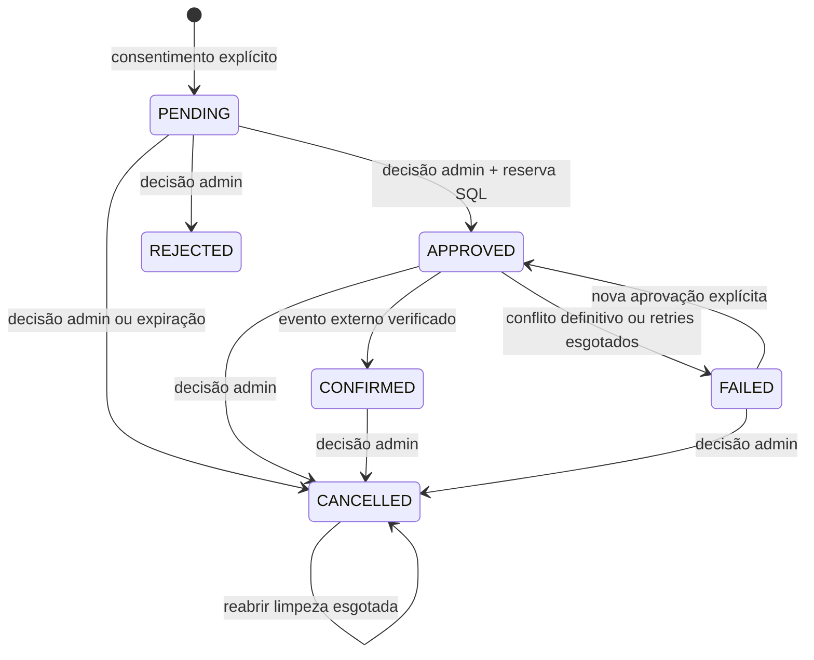
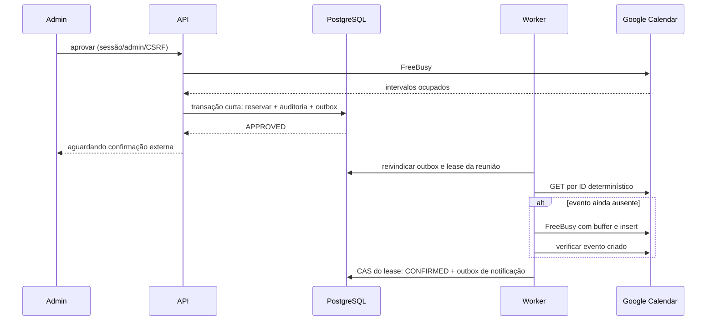

# Reuniões: consistência, estados e privacidade

Estado da retomada: implementação local em andamento, com validação em dependências descartáveis.
A Fase 3 não está encerrada nem homologada nas contas externas. As evidências atuais e os limites
estão na [auditoria da retomada](../testing/phase3-resume-audit.md).

O módulo `apps/orbe-node/src/meetings` concentra as regras de agendamento. Orbe e formulário
chamam o mesmo serviço. PostgreSQL é a fonte de verdade das solicitações e reservas; o Google
Calendar é a fonte externa consultada para os compromissos autorizados. A implementação Java
futura deve usar este serviço, sem criar outra agenda ou repetir suas regras.

## Política e proposta privada

A política confirmada pelo proprietário usa `America/Fortaleza`, segunda a sábado, 09h–18h,
reuniões de 30 minutos, antecedência mínima de 24 horas e intervalo de 15 minutos. Agendamento
continua desabilitado por padrão. Habilitar exige os parâmetros de política explícitos; o
horizonte inicial configurável é 60 dias, com consultas de até sete dias. A grade inicial tem
passos de 15 minutos: uma reunião das 09h às 09h30 bloqueia o início às 09h30 e permite outra
às 09h45, respeitando o intervalo obrigatório de 15 minutos.

Horários são instantes ISO 8601; expediente e dias são calculados no fuso configurado. O serviço
considera início, duração, grade, dias, antecedência, horizonte, compromissos externos e reservas
internas. A política é reavaliada ao preparar a proposta, confirmar o pedido e aprovar; uma
aprovação feita a menos de 24 horas do início também é recusada pela configuração inicial.

Preparar proposta não cria reunião nem evento. O servidor persiste seus dados imutáveis e somente
o SHA-256 de um segredo aleatório de 32 bytes. A proposta expira em 30 minutos. A UI recebe o
resumo e o segredo para pedir confirmação explícita com a versão do consentimento. O resultado
da ferramenta enviado ao modelo não contém esse segredo; a capacidade de confirmação segue
separadamente em `actions` na resposta HTTP. O formulário direto permite evitar o envio de dados
pessoais ao provedor de LLM.

No chat, ferramentas de reunião e `actions` exigem o opt-in explícito
`X-Orbe-Capabilities: meetings-v1`, além de reuniões habilitadas no servidor. Sem esse header,
`POST /api/v1/chat` preserva a resposta legada e não prepara propostas. O frontend deve enviar
o opt-in somente depois de implementar o formulário e a confirmação HTTP do visitante.

Confirmar consome a proposta em transação, vincula a chave de idempotência ao hash do corpo e
cria uma única solicitação `PENDING`, auditoria e outbox. A chave é global e opaca, recomendando-se
UUID aleatório. Repetir chave e corpo devolve a mesma reunião; mudar o corpo gera 409. Consumir
a proposta com outra chave também não cria outra reunião. O segredo da confirmação passa a
servir como token privado de status, persistido somente por hash. A consulta pública devolve
estado, horário e fuso, sem nome, e-mail ou assunto. Tokens nunca devem aparecer em URLs ou logs.

## Máquina de estados

`APPROVED` significa aprovação interna e trabalho de Calendar pendente. `CONFIRMED` exige o evento
externo criado ou recuperado pelo identificador determinístico e verificado pelo adaptador.
`CANCELLED` registra a decisão de cancelamento; `calendar_cancelled_at` registra separadamente a
remoção externa verificada. A reserva de um cancelamento ainda em processamento permanece ativa.
Repetir a mesma decisão concluída é idempotente; transições incompatíveis recebem 409. Rejeição e
cancelamento não permitem reaprovação da mesma solicitação. Login sozinho não concede o papel admin.

## Reserva atômica e operações externas

Solicitações `PENDING` não reservam: vários visitantes podem pedir o mesmo horário. Aprovação faz
FreeBusy fora da transação e depois uma transação curta com advisory lock `81827420` do calendário
único, bloqueio da reunião, atualização,
auditoria e outbox. Uma exclusion constraint GiST protege o intervalo PostgreSQL
`[reserved_start, reserved_end)`, correspondente a `[início, fim + buffer)`. Entre aprovações
concorrentes para intervalos incompatíveis, somente uma vence; a outra recebe 409 e sua transação
faz rollback. A proteção vale entre processos e réplicas usando o mesmo banco.
O lock serializa apenas a reserva local, sem rede dentro da transação. A constraint continua
protegendo escritores que não usem esse lock; conflito GiST ou deadlock abortado retornam 409.

A constraint e a consulta interna dependem de `reserved_start IS NOT NULL`, e não somente do
estado. Um timeout pode ocorrer depois de o Google criar o evento. Por isso `FAILED` com resultado
externo ambíguo mantém a reserva. Um cancelamento também a mantém até a remoção verificada.
A migration `005_calendar_create_uncertainty.sql` acrescenta `calendar_create_uncertain` e marca
conservadoramente reservas antigas sem identidade externa verificada. A flag é persistida antes
de uma tentativa remota de criação e sobrevive a falhas e reinícios.

Um `CALENDAR_CONFLICT` comprovado antes do insert, sem criação anterior incerta, pode liberar a
reserva. Depois de uma tentativa ambígua, o mesmo conflito em um retry não comprova que o evento
anterior deixou de existir e não libera a proteção. `CALENDAR_EVENT_MISMATCH` também conserva a
reserva. Esgotar retries, vencer a lease ou passar tempo não resolve a incerteza externa.

Nenhuma transação ou conexão PostgreSQL permanece ocupada durante chamadas de rede. Leases e
comparação de identificadores de operação impedem uma resposta antiga de substituir uma operação
posterior. A configuração exige uma lease com margem para a sequência de timeouts HTTP. Se a
lease estiver ocupada, o serviço pede retry; não declara sucesso de um trabalho ainda pendente.
Esgotamento também precisa persistir seu resultado antes de o worker parar de recuperá-lo.

Se a remoção externa esgotar as tentativas, um novo comando administrativo de cancelamento pode
reabrir esse trabalho. Isso exige reserva ainda retida, falha `OUTBOX_ATTEMPTS_EXHAUSTED` e lease
ausente ou expirada. A transação incrementa a versão, limpa essa falha, insere novo outbox de
cancelamento e registra `CANCEL_RETRY_REQUESTED` com o administrador responsável. Repetições
durante o novo processamento ou depois da remoção verificada não criam ciclos adicionais.
O callback de esgotamento recebe obrigatoriamente a versão do outbox; a atualização faz CAS
nessa versão. Assim, a recuperação de um trabalho antigo não encerra uma nova tentativa administrativa.

O ID do evento é `m` seguido do UUID da reunião sem hífens. Retries recuperam e verificam esse
mesmo evento, em vez de gerar novos IDs. Se cancelamento ocorrer durante criação, a decisão e o
outbox ficam persistidos; uma criação tardia registra o ID externo e mantém a compensação de
cancelamento. A reserva só é liberada pelo CAS após remoção verificada. A notificação de
cancelamento também espera esse resultado, exceto na expiração de um pedido nunca aprovado.

Quando há criação incerta sem `external_event_id` verificado, um GET `404` não finaliza o
cancelamento: o insert anterior pode ainda terminar depois da consulta. O adaptador retorna
`CALENDAR_RECONCILIATION_PENDING`; o worker tenta reconciliar o mesmo ID e mantém a reserva.
Um evento recuperado e pertencente à reunião pode ser removido e sua remoção verificada;
evidência de evento já cancelado também permite concluir. Sem evidência suficiente, a reserva
pode permanecer retida indefinidamente, inclusive após esgotar retries. Não há prazo automático
de liberação nem comando para ignorar essa proteção por alteração direta do SQL.

## Outbox, falhas e retenção

Estado, auditoria e eventos de saída são gravados na mesma transação. O outbox contém UUID da
reunião, tipo e versão, com unicidade por reunião/tipo/versão. Redis/BullMQ recebe somente o UUID
do outbox. O worker busca os dados necessários no PostgreSQL, usa leases e retries com backoff e
registra entregas por canal. Falha de notificação não desfaz aprovação ou confirmação. Lembretes
verificam a versão e o estado atual antes de enviar.

Pedidos `PENDING` expiram quando o fim do horário passou ou após sete dias sem decisão, na próxima
rotina de retenção. São cancelados sem criar evento e recebem auditoria. Propostas não consumidas
expiradas são removidas. Depois da retenção configurada, inicialmente 90 dias, nome, e-mail e
assunto de registros antigos terminais ou confirmados já encerrados são substituídos e o token de
consulta é invalidado; metadados de estado e auditoria permanecem. A mesma remoção de PII alcança
a proposta consumida. As políticas dos provedores externos e das identidades de login são
responsabilidades separadas da retenção desta tabela.

## Limites e operação

- FreeBusy e insert do Google não formam uma transação atômica. Outra aplicação pode criar um
  compromisso entre a consulta e o insert. A exclusão SQL protege as reservas desta plataforma;
  não representa bloqueio global de todos os escritores da agenda externa.
- Após falha ambígua esgotada, a reserva fica protegida e a falha continua observável. Se uma nova
  aprovação encontrar o próprio evento externo ocupando o horário, o caminho seguro é cancelar,
  verificar a compensação e preparar nova solicitação. Não limpar reservas diretamente no SQL.
- Um `404` isolado durante criação incerta não prova que uma escrita remota foi abortada. A
  recuperação pode exigir intervenção e investigação autorizadas; testes locais não demonstram
  todos os comportamentos de consistência do Google real.
- Entregas de e-mail/Telegram podem ser ambíguas em falhas de transporte; o controle local evita
  processamento simultâneo e retries ilimitados, sem prometer entrega externa exatamente uma vez.
- Calendar fake é marcado `simulated:true` nas propostas e disponibilidade e é proibido em produção.
  Nenhum teste local prova disponibilidade ou credenciais reais do proprietário.
- Login Google OIDC e autorização OAuth para a agenda usam clientes, credenciais e finalidades
  independentes. Nenhum token de integração é devolvido ao navegador ou ao modelo.

Os testes de unidade usam calendário simulado. A suíte PostgreSQL descartável cobre propostas e
hashes, consentimento, retries concorrentes, exclusion constraint, buffer, ausência de conexão
retida durante rede, confirmação, falhas, compensação de cancelamento, retenção e recuperação
após lease ativa. Os resultados de execução final são registrados na documentação de testes;
a presença de um cenário no código não constitui evidência de homologação com Google real.
