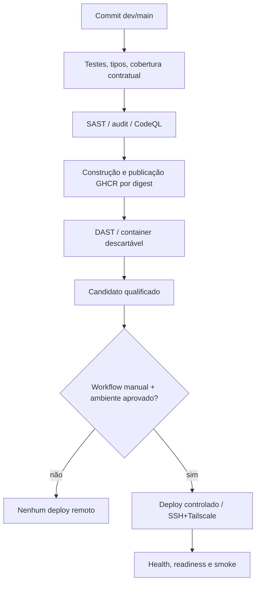

# Ambientes, branches, CI/CD e releases

[← Wiki](README.md) · [Arquitetura](arquitetura.md) · [Qualidade](qualidade-e-seguranca.md)

## 1. Duas codebases, dois pares DEV/MAIN

| Contexto | Frontend | Backend |
| --- | --- | --- |
| Desenvolvimento | `https://devgbc.phasscode.com` | `https://devapi.phasscode.com` |
| Produção | `https://gbc.phasscode.com` | `https://api.phasscode.com` |
| Origem | [`web-portfolio-v2`](https://github.com/SladeSouzaSantos/web-portfolio-v2) | [`phasscode-platform`](https://github.com/SladeSouzaSantos/phasscode-platform) |
| Checkouts backend | — | DEV: `/opt/projects/phasscode-platform-dev` · PROD: `/opt/projects/phasscode-platform` |

**Esta tabela descreve endereços e checkouts documentados, não prova que o último commit do GitHub esteja implantado.** O estado real exige consulta às releases, labels/digests e verificações no servidor.

## 2. Situação das branches no momento da revisão

Comparação via API GitHub em 06/11/2026:

- Backend: `dev` (`747cd8243a…`) está **3 commits atrás** de `main` (`c302ec4442…`), sem arquivos novos exclusivos de `dev` no comparador `main...dev`. Isso significa que não se deve afirmar automaticamente que todo recurso do main também está implantado em DEV.
- Frontend: `dev` (`d8b7bfbc8d…`) está **37 commits à frente** de `main` (`5514b5ac66…`). O diferencial concentrado em 13 arquivos inclui Playwright live DEV, workflow, runner/preflight e documentação. **Não significa que as suítes live tenham sido executadas/aprovadas**.

Verifique a cada revisão: [comparação backend](https://github.com/SladeSouzaSantos/phasscode-platform/compare/main...dev), [comparação frontend](https://github.com/SladeSouzaSantos/web-portfolio-v2/compare/main...dev).

## 3. O que acontece no GitHub Actions

A ordem exata de jobs/condições difere entre os workflows:

- Backend: [`.github/workflows/ci.yml`](../../.github/workflows/ci.yml) e [`deploy.yml`](../../.github/workflows/deploy.yml).
- Frontend: [`deploy.yml`](https://github.com/SladeSouzaSantos/web-portfolio-v2/blob/main/.github/workflows/deploy.yml).
- Pares compatíveis: [`scripts/release-pair-gate.mjs` frontend](https://github.com/SladeSouzaSantos/web-portfolio-v2/blob/main/scripts/release-pair-gate.mjs) e integrações documentadas.

**Um push não faz deploy remoto por si só**. Os workflows possuem opção manual de aplicação remota, proteções e credenciais específicas, além dos gates de testes e imagens.

## 4. Docker Compose e isolamento

O backend usa [`compose.yaml`](../../compose.yaml) e overlays de desenvolvimento/teste. Os serviços possuem isolamento por **Compose project**, variáveis, portas loopback e volumes próprios.

- DEV backend: projeto `phasscode-platform-dev`, documentado em `/opt/projects/phasscode-platform-dev`, geralmente com acesso HTTP loopback em `3001`.
- Produção: projeto `phasscode-platform`, com `PHASSCODE_HTTP_PORT` validada no ambiente, sem pressupor porta fixa livre.
- PostgreSQL e Redis não devem compartilhar acidentalmente volumes entre DEV/MAIN.
- Graph Reader/Neo4j e overlays `shadow`/`active` são **opt-in DEV**. Não expor portas de banco/Reader publicamente nem montar secrets no serviço externo sem necessidade.
- Nunca executar `docker compose down --volumes` de modo indiscriminado em checkouts com dados reais.

Referências: [operação oficial no MiniMac](../deployment/README.md), [overlays GraphRAG](../graph-rag-active-dev.md), [`scripts/compose.sh`](../../scripts/compose.sh).

## 5. Ordem recomendada para uma release

1. Definir requisitos/issue e branch de desenvolvimento, registrar mudanças de contrato.
2. Qualificar backend e frontend (testes, SAST, smoke, compatibilidade entre SHA).
3. Quando há mudança de API, publicar **backend compatível antes do frontend**.
4. Exigir aprovação explícita para `apply_remote=true` e verificar environment correto.
5. Conferir saúde/readiness, origem CORS, versão SHA/digest e respostas públicas do Orbe.
6. Validar, com perguntas de recrutadores e fontes, o que testes automatizados de contrato não julgam semanticamente.
7. Só após homologação aprovar promoção DEV→MAIN, com rollback conhecido.

**Não usar a wiki como autorização de deploy**. O procedimento operacional sensível está nos scripts/versionamentos e exige revisão do executor.

## 6. Live Playwright é um gate específico

A branch `dev` do frontend introduz [Playwright Live para Orbe](https://github.com/SladeSouzaSantos/web-portfolio-v2/blob/dev/docs/ORBE-LIVE-PLAYWRIGHT-DEV.md), com autorização explícita e SHA esperado, sem chamadas automáticas de LLM por qualquer alteração. O smoke e o extended possuem cenários conhecidos, retenção de relatório limitada e exigência de revisão humana.

**Um smoke mock não comprova qualidade de LLM; um teste live não comprova GraphRAG ativado.** A fase de GraphRAG requer checks próprios de Reader, Neo4j, proveniência e isolamento.

## 7. Falhas e rollback

- Erro de quota ou provedor: inspecionar códigos e Redis sem registrar token/headers; não limpar quotas arbitrariamente.
- Erro de migrations/readiness: **não** promover release; reconciliar versão de esquema, backup e imagem.
- Falha em GraphRAG opt-in DEV: retornar à configuração canônica sem remover volumes.
- Falha em frontend: preferir imagem/digest anterior, preservando par compatível com backend.
- Sempre preservar dados e segredos de ambos os ambientes e registrar a evidência de homologação.

Leituras obrigatórias: [deploy backend](../deployment/README.md), [README backend](../../README.md), [README frontend](https://github.com/SladeSouzaSantos/web-portfolio-v2/blob/main/README.md), [segurança](../security.md).
