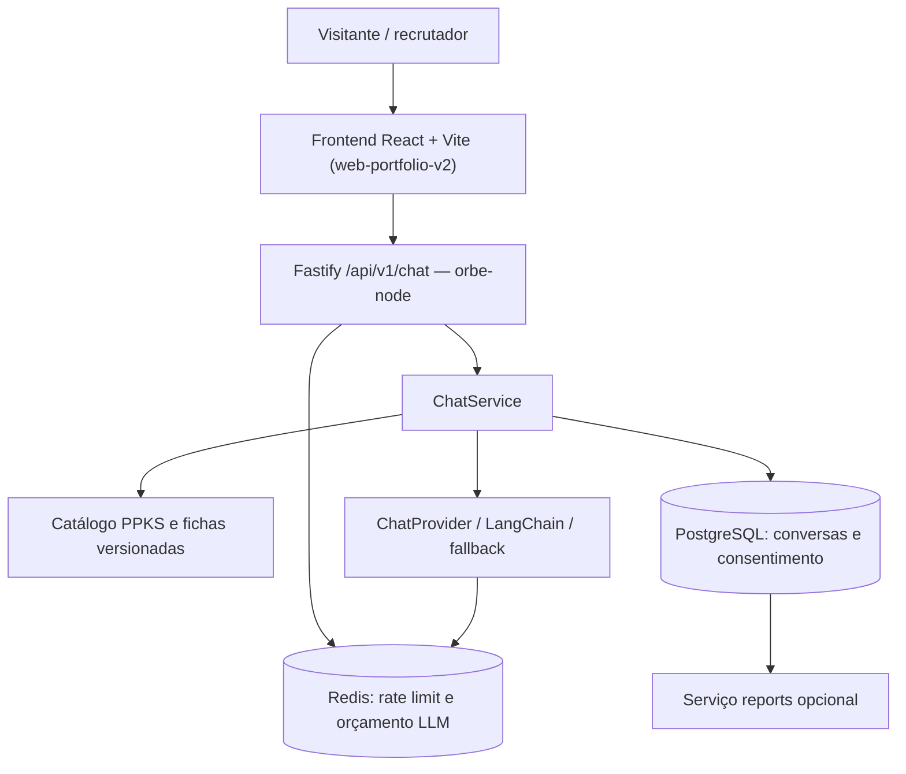
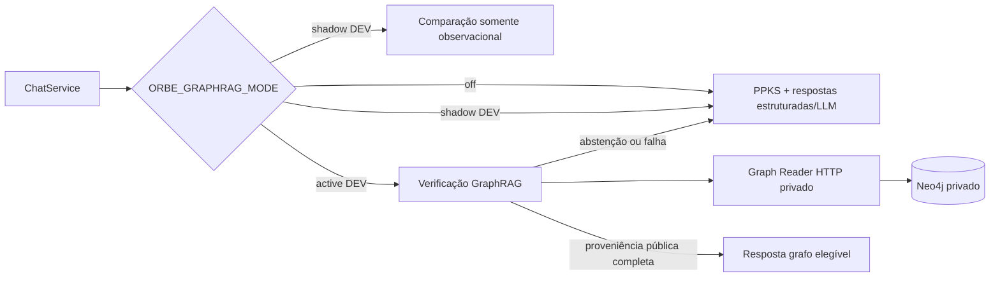

# Arquitetura geral do PHASSCODE

[← Índice da wiki](README.md) · [Backend](backend.md) · [Frontend](frontend.md) · [Orbe](orbe-fluxo-de-resposta.md)

## Visão de componentes — runtime público

**Fonte principal:** [inicialização do backend](../../apps/orbe-node/src/main.ts), [montagem Fastify](../../apps/orbe-node/src/http/app.ts), [orquestração do chat](../../apps/orbe-node/src/application/chat.ts), [App React](https://github.com/SladeSouzaSantos/web-portfolio-v2/blob/main/src/App.tsx). O diagrama representa responsabilidades, não uma topologia física exata.

## Camadas e responsabilidades

| Camada         | Responsabilidade                                            | Implementação                                                                                                                                  |
| -------------- | ----------------------------------------------------------- | ---------------------------------------------------------------------------------------------------------------------------------------------- |
| Interface      | Seções, navegação, tema, modal, histórico do chat, fontes   | [Frontend `src/`](https://github.com/SladeSouzaSantos/web-portfolio-v2/tree/main/src)                                                          |
| Transporte     | Parse e validação HTTP, CORS, headers, erros, limites       | [`http/app.ts`](../../apps/orbe-node/src/http/app.ts), [`packages/contracts/`](../../packages/contracts/)                                      |
| Aplicação      | Orquestrar turnos, decisões, contexto, políticas, respostas | [`application/chat.ts`](../../apps/orbe-node/src/application/chat.ts)                                                                          |
| Domínio        | Interfaces estáveis para storage/provedor/conhecimento      | [`domain/ports.ts`](../../apps/orbe-node/src/domain/ports.ts), [`domain/evidence-graph.ts`](../../apps/orbe-node/src/domain/evidence-graph.ts) |
| Adaptadores    | PostgreSQL, JSON, Redis, provedores LLM e Graph Reader      | [`adapters/`](../../apps/orbe-node/src/adapters/)                                                                                              |
| Conhecimento   | Fatos, fichas PPKS, fontes, relações semânticas curadas     | [`knowledge/`](../../knowledge/)                                                                                                               |
| Infraestrutura | Docker Compose, migrations, CI/CD, deploy                   | [`compose.yaml`](../../compose.yaml), [workflow](../../.github/workflows/deploy.yml)                                                           |

Essa separação tem uma finalidade prática: o caso de uso recebe **portas** como `ConversationStore`, `KnowledgeRepository` e `ChatProvider`; trocar infraestrutura não deveria obrigar o domínio a tratar diretamente protocolos HTTP, SQL ou chaves de provedor. O mesmo princípio explica por que o adaptador HydraDB só foi testado isoladamente.

## GraphRAG opcional — não confundir com o caminho canônico

O modo padrão no código é **`off`**. `shadow` produz observação sem alterar a resposta entregue; `active` é **opt-in e DEV-only**, com guardrails, provas de fonte e fallback. A API pública não recebe as credenciais de Neo4j/Bolt: o [Reader interno](../../apps/orbe-node/src/graph-reader/app.ts) fica separado da [API externa](../../apps/orbe-node/src/http/app.ts).

Consulte [guia active DEV](../graph-rag-active-dev.md), [guia shadow DEV](../graph-rag-shadow-dev.md), [regras de isolamento](../graph-rag-security-boundary.md) e [adapter HTTP](../../apps/orbe-node/src/adapters/graph-reader-http.ts). **A presença de código GraphRAG não prova que esteja ativo no servidor.**

## Perspectivas operacionais distintas

| Vista                        | `dev`                                  | `main`                             |
| ---------------------------- | -------------------------------------- | ---------------------------------- |
| Objetivo                     | Homologação e testes antes de promoção | Produção e release aprovada        |
| Frontend conhecido           | `devgbc.phasscode.com`                 | `gbc.phasscode.com`                |
| Backend conhecido            | `devapi.phasscode.com`                 | `api.phasscode.com`                |
| Checkout backend documentado | `/opt/projects/phasscode-platform-dev` | `/opt/projects/phasscode-platform` |
| GraphRAG `shadow` / `active` | Apenas por aprovação/overlay           | Não parte do deploy padrão         |
| Promoção                     | Exige checagem da release/testes       | Merge e deploy não são sinônimos   |

Links: [README backend](../../README.md), [README frontend](https://github.com/SladeSouzaSantos/web-portfolio-v2/blob/main/README.md), [operação](../deployment/README.md).

## Limites de escopo e documentação legada

O produto **público atual não oferece login, painel administrativo, reuniões, calendário nem notificações**. O repositório ainda guarda parte de `auth/`, `meetings/`, `worker-node/`, migrations e testes históricos, mas [`main.ts`](../../apps/orbe-node/src/main.ts) inicia o [`buildApp`](../../apps/orbe-node/src/http/app.ts) com `publicOnly: true`, e o frontend [`App.tsx`](https://github.com/SladeSouzaSantos/web-portfolio-v2/blob/main/src/App.tsx) não roteia essas interfaces. Não os descrever como recursos disponíveis.

O **HydraDB** permanece laboratório à parte, em `experiment/hydradb`; não integra `dev` nem `main`. Os estudos de ONNX/embeddings e planejadores semânticos também possuem avaliações de laboratório; não implicam inferência ONNX em produção.

### Referências arquiteturais históricas

- [ADRs iniciais](../adr/0001-foundation.md), [chat/persistência](../adr/0002-chat-and-storage.md), [evolução](../adr/0003-infrastructure-and-evolution.md).
- [Arquitetura inicial](../architecture/overview.md) — pode conter funcionalidades descontinuadas; consultar com as ressalvas acima.
- [PPKS](../../knowledge/ppks/README.md) e [modelos/contratos](../../apps/orbe-node/src/domain/).
