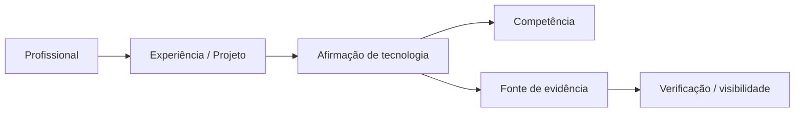

# Conhecimento, PPKS e evidências do Orbe

[← Wiki](README.md) · [Fluxo do Orbe](orbe-fluxo-de-resposta.md)

## 1. Por que manter um esquema próprio?

O objetivo não é apenas responder a perguntas de texto livre: é diferenciar **fatos de carreira, afirmações técnicas, inferências transferíveis e fontes verificáveis**. A fonte de fatos permanece no repositório e não é deduzida automaticamente pelo modelo LLM.

O [`knowledge/portfolio.json`](../../knowledge/portfolio.json) reúne o catálogo legível pelo Orbe. As fichas estruturadas [`knowledge/ppks/`](../../knowledge/ppks/) aprofundam cada experiência/projeto e registram proveniência, tecnologia, natureza e revisão. Um índice compacto [`knowledge/ppks/index.json`](../../knowledge/ppks/index.json) apoia a curadoria.

## 2. Modelo conceitual

No grafo tipado, um registro de projeto ou vínculo profissional se relaciona a competências; cada claim conserva referências individuais de fontes, em vez de virar uma associação genérica "sabe tecnologia". O [`evidence-graph.ts`](../../apps/orbe-node/src/domain/evidence-graph.ts) define os schemas; o [`ppks-evidence-graph.ts`](../../apps/orbe-node/src/adapters/ppks-evidence-graph.ts) projeta fichas em snapshot tipado somente de leitura.

## 3. Estado da evidência e escopo

| Conceito               | Interpretação de produto                                                       |
| ---------------------- | ------------------------------------------------------------------------------ |
| `professional`         | Fonte vinculada a trabalho documentado                                         |
| `mixed_role`           | Atuação mista em engenharia e software; não chamar de cargo exclusivamente Dev |
| `professional_project` | Projeto profissional autoral documentado                                       |
| `personal_project`     | Projeto pessoal; não equivale a contratação                                    |
| `study`                | Formação/exercício; não é vínculo de emprego                                   |
| `unknown`              | Natureza ou verificação insuficiente; não promover silenciosamente             |
| `code_reviewed`        | Há inspeção de evidência/código conforme ficha curada                          |
| `catalog_only`         | Declaração/catálogo; não implica auditoria linha a linha                       |

A ficha do [PPKS](../../knowledge/ppks/README.md) diferencia `verified`, `declared`, `inferred` e fatos ainda não confirmados. **Inferência de proximidade não comprova trabalho realizado.** Exemplo: Java pode sugerir fundamentos transferíveis de POO para React, mas não substitui evidência de uso de React no projeto.

## 4. Como a recuperação funciona

### Recuperação lexical

[`JsonKnowledgeRepository`](../../apps/orbe-node/src/adapters/knowledge.ts) analisa a consulta, busca documentos relevantes e aplica regras de relevância/especialização. A recuperação deve preservar histórico de carreira, catálogo acadêmico e cobertura de requisitos quando a pergunta exige múltiplas tecnologias.

### Relações semânticas curadas

[`SemanticKnowledgeGraph`](../../apps/orbe-node/src/adapters/semantic-graph.ts) carrega o grafo pequeno de conceitos em [`knowledge/ppks/semantic-relations.json`](../../knowledge/ppks/semantic-relations.json), valida estrutura/relações e usa conexões para sugerir documentos relevantes. É **grafo semântico de conhecimento versionado**, não um embedding ONNX nem um LLM de inferência ilimitada.

### Grafo de evidências opcional

`projectPpksEvidenceGraph` converte fichas em entidades e relações, com fonte e escopo individual. No modo GraphRAG DEV opt-in, o [`GraphReaderHttpRepository`](../../apps/orbe-node/src/adapters/graph-reader-http.ts) lê projeções autorizadas do Neo4j privado e o [`PublicGraphEvidenceGateway`](../../apps/orbe-node/src/application/graph-public-policy.ts) aplica limites de proveniência antes de construir respostas.

### Embeddings e pesquisa experimental

Os estudos [semânticos F3.7](../architecture/semantic-strict-fusion-v2.md) e de [ONNX no MiniMac](../architecture/minimac-f37-benchmark.md) **não** são parte obrigatória do runtime público; a adoção foi adiada por critérios de precisão, dados fora de catálogo, memória, latência e ausência de validação humana suficiente.

O experimento [HydraDB](https://github.com/SladeSouzaSantos/phasscode-platform/tree/experiment/hydradb) mede portabilidade de interface e persistência no laboratório; **não substituiu o Neo4j no Orbe**.

## 5. Como atualizar uma competência/projeto

1. Atualizar ou corrigir o catálogo `knowledge/portfolio.json`.
2. Atualizar ficha do projeto/vínculo em `knowledge/ppks/projects/` ou `experiences/`, incluindo `sourceRef`, `sourceCommit`, `verificationStatus`, referências e limites do que foi verificado.
3. Gerar/validar `index.json` com `npm run ppks:index` e `npm run ppks:check`.
4. Conferir o conteúdo visual equivalente no [frontend `src/data/`](https://github.com/SladeSouzaSantos/web-portfolio-v2/tree/main/src/data).
5. Rodar testes de recuperação e de respostas de recrutadores.
6. Para promoção DEV/MAIN, validar respostas com fontes em cenário real antes de publicar.

O sincronizador futuro de projetos descrito no PPKS **não deve ser considerado implementado** só porque há um plano. Também não utilizar `repo.updated_at` como prova de modificação de um projeto; preferir SHA e caminho exatos.

## 6. Exemplo de invariante essencial

Se uma vaga pede **Go**, uma claim Java com evidência profissional pode explicar **transferibilidade**, mas não pode ser reclassificada como experiência Go. Da mesma forma, um curso concluído não pode ser convertido em graduação completa. Esse controle deve aparecer simultaneamente na **recuperação, composição de contexto, política de resposta e testes**.

Leituras: [`knowledge/ppks/README.md`](../../knowledge/ppks/README.md), [contrato do grafo](../../apps/orbe-node/src/domain/evidence-graph.ts), [regras de resposta](../../apps/orbe-node/src/application/professional-response-policy.ts), [matriz de recrutador](../../apps/orbe-node/src/application/recruiter-matrix.ts), [índice curado](../orbe/evidence-index.md).
