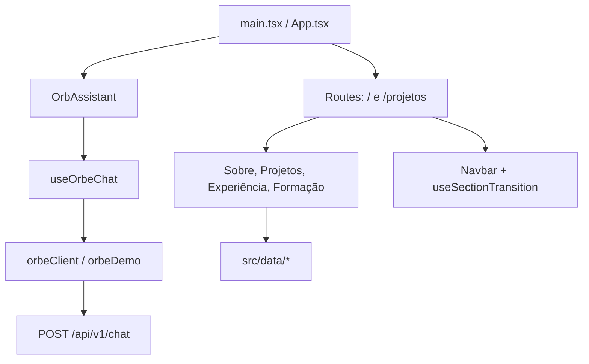

# Frontend — React, navegação e interface do Orbe

[← Wiki](README.md) · [Arquitetura](arquitetura.md) · [Fluxo do Orbe](orbe-fluxo-de-resposta.md)

**Fonte:** [`web-portfolio-v2`](https://github.com/SladeSouzaSantos/web-portfolio-v2), `main` para as funcionalidades públicas e `dev` para as suítes live extras. A wiki central fica no repositório backend, mas os links abaixo apontam para o código verdadeiro do frontend.

## Fluxo de componentes



## Arquivos para estudar

| Código | Papel |
| --- | --- |
| [`src/App.tsx`](https://github.com/SladeSouzaSantos/web-portfolio-v2/blob/main/src/App.tsx) | Rotas, páginas, seleção de seções e montagem do Orbe |
| [`Navbar.tsx`](https://github.com/SladeSouzaSantos/web-portfolio-v2/blob/main/src/components/Navbar.tsx) | Navegação e troca de tema |
| [`useSectionNavigation.ts`](https://github.com/SladeSouzaSantos/web-portfolio-v2/blob/main/src/hooks/useSectionNavigation.ts) | Traduz hash para seção |
| [`useSectionTransition.tsx`](https://github.com/SladeSouzaSantos/web-portfolio-v2/blob/main/src/hooks/useSectionTransition.tsx) | Transição circular e controle de navegação |
| [`useTheme.ts`](https://github.com/SladeSouzaSantos/web-portfolio-v2/blob/main/src/hooks/useTheme.ts) | Estado de tema |
| [`sitePreloader.ts`](https://github.com/SladeSouzaSantos/web-portfolio-v2/blob/main/src/lib/sitePreloader.ts) | Preloader inicial |
| [`src/sections/`](https://github.com/SladeSouzaSantos/web-portfolio-v2/tree/main/src/sections) | Sobre, Projetos, Experiência, Formação e Arquivo de Missões |
| [`src/data/`](https://github.com/SladeSouzaSantos/web-portfolio-v2/tree/main/src/data) | Dados visíveis, não a fonte canônica do Orbe |

A página `/` monta `PortfolioPage`, com quatro seções por hash. `/projetos` abre `ArquivoProjetos`. A rota `/administracao` redireciona para `/#sobre`: **não há painel administrativo público**. Os caminhos antigos têm redirecionamentos de compatibilidade.

## Como o chat funciona

```text
OrbAssistant.tsx — canvas, modal, texto, fontes, teclado, copiar e maximizar
      ↓
useOrbeChat.ts — mensagens, envio, cancelamento, erro, cooldown e consentimento
      ↓
orbeClient.ts — HTTP, token da conversa, parse/validação e limite de payload
      ↓
Backend Fastify — /api/v1/chat
```

### Interface: `OrbAssistant.tsx`

[Arquivo](https://github.com/SladeSouzaSantos/web-portfolio-v2/blob/main/src/components/OrbAssistant.tsx). Renderiza a esfera animada, modal, transcrição e fontes. **Enter envia, Shift+Enter insere linha**, com proteção para composição IME e suporte a movimento reduzido.

### Estado: `useOrbeChat.ts`

[Arquivo](https://github.com/SladeSouzaSantos/web-portfolio-v2/blob/main/src/hooks/useOrbeChat.ts).

- Usa `AbortController` para cancelar e não atualizar componente desmontado.
- Mantém transcrição recente e saudação; isso **não** autoriza recuperar a conversa do backend sem token.
- Impede duas requisições simultâneas, controla limite de turnos e mensagens de erro tipadas.
- Chama API real se `VITE_ORBE_API_ENABLED` estiver habilitada; caso contrário responde via demonstração local.
- Controla opt-in explícito de relatórios antes do início, travamento do estado e revogação posterior.

### HTTP: `orbeClient.ts`

[Arquivo](https://github.com/SladeSouzaSantos/web-portfolio-v2/blob/main/src/services/orbeClient.ts). Monta `POST /api/v1/chat`, conserva `conversationId`/token efêmero, valida respostas, aplica timeout/abort e trata `Retry-After`. Limite do cliente: **2.000 caracteres** por mensagem; corpo HTTP até **8.192 bytes**. O browser não conhece credenciais nem escolhe o provedor LLM.

## Dados e páginas

- [`src/data/perfil.ts`](https://github.com/SladeSouzaSantos/web-portfolio-v2/blob/main/src/data/perfil.ts): perfil exibido.
- [`src/data/projetos.ts`](https://github.com/SladeSouzaSantos/web-portfolio-v2/blob/main/src/data/projetos.ts): projetos destacados da Guilda.
- [`src/data/arquivoProjetos.ts`](https://github.com/SladeSouzaSantos/web-portfolio-v2/blob/main/src/data/arquivoProjetos.ts): Arquivo de Missões.
- [`src/data/experiencias.ts`](https://github.com/SladeSouzaSantos/web-portfolio-v2/blob/main/src/data/experiencias.ts): linha do tempo.
- [`src/data/formacoes.ts`](https://github.com/SladeSouzaSantos/web-portfolio-v2/blob/main/src/data/formacoes.ts): formação/cursos.

Atualizações importantes precisam manter **apresentação frontend** e **catálogo PPKS backend** coerentes.

## DEV versus MAIN e código histórico

A branch `dev` adiciona testes Playwright **live**, executados só com aprovação: [guia](https://github.com/SladeSouzaSantos/web-portfolio-v2/blob/dev/docs/ORBE-LIVE-PLAYWRIGHT-DEV.md), [teste](https://github.com/SladeSouzaSantos/web-portfolio-v2/blob/dev/tests/orbe-live.spec.ts). Um teste mock não prova respostas corretas da LLM, e uma execução live não comprova sozinha GraphRAG ativo.

Componentes antigos de autenticação, reuniões e painel ainda podem existir no Git, mas não são importados na interface pública atual. Para desenvolver, consulte o [README do frontend](https://github.com/SladeSouzaSantos/web-portfolio-v2/blob/main/README.md) e [os testes](https://github.com/SladeSouzaSantos/web-portfolio-v2/tree/main/tests).

**Próximo:** [fluxo detalhado do Orbe](orbe-fluxo-de-resposta.md).
