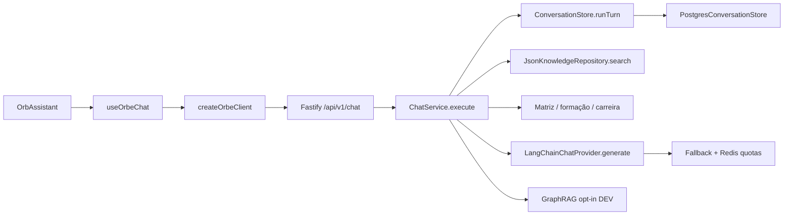

# Mapa do código — navegação por módulo e função

[← Índice da wiki](README.md) · [Backend](backend.md) · [Frontend](frontend.md) · [Guia de desenvolvimento](guia-do-desenvolvedor.md)

**Escopo da leitura:** backend `main` `c302ec444266`, frontend `main` `5514b5ac6626`; diferenças `dev` são indicadas separadamente em [ambientes](ambientes-deploy.md). Esta é a **segunda camada** da wiki: rastreia **símbolos e regras principais**, mas não declara ter auditado cada função dos 474 arquivos backend e 216 arquivos frontend.

## Caminho crítico do produto

### Guias aprofundados

| Subsistema          | Guia                                                                          | Implementação principal                                                                                                                                              |
| ------------------- | ----------------------------------------------------------------------------- | -------------------------------------------------------------------------------------------------------------------------------------------------------------------- |
| Decisão de um turno | [`ChatService.execute` anotado](modulos/chatservice.md)                       | [`application/chat.ts`](../../apps/orbe-node/src/application/chat.ts)                                                                                                |
| API e sessão        | [Ciclo HTTP ponta a ponta](modulos/api-e-sessao.md)                           | [`http/app.ts`](../../apps/orbe-node/src/http/app.ts) + [`orbeClient.ts`](https://github.com/SladeSouzaSantos/web-portfolio-v2/blob/main/src/services/orbeClient.ts) |
| Conhecimento        | [Pipeline PPKS, lexical e evidências](modulos/ppks-e-recuperacao.md)          | [`knowledge.ts`](../../apps/orbe-node/src/adapters/knowledge.ts)                                                                                                     |
| IA                  | [Provedor, orçamentos e fallback](modulos/llm-e-orcamento.md)                 | [`langchain-provider.ts`](../../apps/orbe-node/src/adapters/langchain-provider.ts)                                                                                   |
| GraphRAG            | [Reader, Neo4j, Shadow e Active](modulos/graphrag-e-reader.md)                | [`graph-active-answer.ts`](../../apps/orbe-node/src/application/graph-active-answer.ts)                                                                              |
| Estado durável      | [PostgreSQL, concorrência e relatórios](modulos/persistencia-e-relatorios.md) | [`postgres-store.ts`](../../apps/orbe-node/src/adapters/postgres-store.ts)                                                                                           |
| Interface           | [React, chat, rotas e animações](modulos/frontend-fluxos.md)                  | [Frontend `src/`](https://github.com/SladeSouzaSantos/web-portfolio-v2/tree/main/src)                                                                                |
| Testabilidade       | [Matriz código × teste](modulos/matriz-testes.md)                             | [Backend `tests/`](../../tests/), [Frontend `tests/`](https://github.com/SladeSouzaSantos/web-portfolio-v2/tree/main/tests)                                          |

## Catálogo de símbolos principais — backend

| Símbolo verificado no código                                                                            | Entrada e papel                                                     | Chamadas/dependências                                                                          |
| ------------------------------------------------------------------------------------------------------- | ------------------------------------------------------------------- | ---------------------------------------------------------------------------------------------- |
| [`main.ts` bootstrap](../../apps/orbe-node/src/main.ts)                                                 | Lê config, monta dependências, inicia servidor                      | `loadConfig`, `JsonKnowledgeRepository.load`, `buildApp`, stores, GraphRAG opcional            |
| [`buildApp`](../../apps/orbe-node/src/http/app.ts#L40-L109)                                             | Config/portas → instância Fastify                                   | Helmet, CORS, limiter, `ChatService`, endpoints                                                |
| [`ChatService.execute`](../../apps/orbe-node/src/application/chat.ts#L77-L546)                          | DTO + token + consentimento → `ChatResponse`                        | `ConversationStore.runTurn`, `knowledge.search`, respostas determinísticas, GraphRAG, provider |
| [`JsonKnowledgeRepository.load`](../../apps/orbe-node/src/adapters/knowledge.ts#L165-L182)              | Carrega/valida catálogo, fichas acadêmicas e semântica              | PPKS e `SemanticKnowledgeGraph`                                                                |
| [`JsonKnowledgeRepository.search`](../../apps/orbe-node/src/adapters/knowledge.ts#L209-L687)            | Pergunta → lista de `KnowledgeDocument`                             | Lexical, categorias, vínculos, trilhas, skills e curadoria                                     |
| [`buildEvidencePacket`](../../apps/orbe-node/src/application/evidence-packet.ts#L19-L167)               | Fontes + orçamento + tecnologias → contexto reduzido ou `null`      | Preserva requisitos distintos e evidências explícitas                                          |
| [`reconcileCanonicalAcademicClaims`](../../apps/orbe-node/src/application/canonical-claims.ts#L14-L219) | Texto gerado + fatos acadêmicos → correção controlada e referências | Status/contagens canônicas                                                                     |
| [`LangChainChatProvider.generate`](../../apps/orbe-node/src/adapters/langchain-provider.ts#L89-L455)    | Mensagens e documentos → texto e fontes                             | Prompt v4, modelo, tool rounds e orçamento                                                     |
| [`RedisLlmCallBudget.reserve`](../../apps/orbe-node/src/adapters/redis-llm-budget.ts#L68-L100)          | Reserva quota global/provedor                                       | Script Lua atômico Redis                                                                       |
| [`createRedisFallbackInvocationFactory`](../../apps/orbe-node/src/adapters/fallback-llm.ts#L113-L164)   | Config e Redis → invocador com candidatos                           | Orçamentos por provedor, cooldown, controller                                                  |
| [`PostgresConversationStore.runTurn`](../../apps/orbe-node/src/adapters/postgres-store.ts#L18-L140)     | ID/hash/operador → resposta transacional                            | BEGIN, lock NOWAIT, histórico, COMMIT/ROLLBACK                                                 |
| [`projectPpksEvidenceGraph`](../../apps/orbe-node/src/adapters/ppks-evidence-graph.ts#L118-L291)        | PPKS → snapshot tipado                                              | Claims, fontes, escopos, esquema validado                                                      |
| [`GraphReaderHttpRepository`](../../apps/orbe-node/src/adapters/graph-reader-http.ts#L44-L151)          | Requisitos/ID → dados públicos do Reader                            | HTTP privado, timeout/limites/Zod                                                              |
| [`createGraphRagActive`](../../apps/orbe-node/src/application/graph-active-answer.ts#L92-L222)          | Snapshot/Reader → resposta grafo elegível ou abstenção              | Cobertura, fontes públicas, análise, auditoria                                                 |
| [`createGraphRagShadow`](../../apps/orbe-node/src/application/graph-rag-shadow.ts#L33-L62)              | Pergunta → observação                                               | Não substitui a resposta canônica                                                              |
| [`buildInternalGraphReader`](../../apps/orbe-node/src/graph-reader/app.ts#L33-L95)                      | Porta privada → HTTP de leitura, auth, Zod                          | `PublicGraphEvidenceGateway`, Neo4j atrás do serviço                                           |
| [`Neo4jGraphStore`](../../apps/orbe-node/src/adapters/neo4j-driver-store.ts#L43-L144)                   | Seeds e consultas aprovadas                                         | Cypher estático/allowlist, driver privado                                                      |
| [`report-node/main.ts`](../../apps/report-node/src/main.ts)                                             | Métricas agregadas → entregas Telegram                              | Banco, leases e confirmações; opt-in                                                           |

## Catálogo de símbolos principais — frontend

| Símbolo                                                                                                                              | Finalidade                                           |
| ------------------------------------------------------------------------------------------------------------------------------------ | ---------------------------------------------------- |
| [`App`](https://github.com/SladeSouzaSantos/web-portfolio-v2/blob/main/src/App.tsx#L48-L67)                                          | Mapeamento das rotas públicas                        |
| [`PortfolioPage`](https://github.com/SladeSouzaSantos/web-portfolio-v2/blob/main/src/App.tsx#L20-L41)                                | Seção ativa, navbar, transição e Orbe                |
| [`OrbAssistant`](https://github.com/SladeSouzaSantos/web-portfolio-v2/blob/main/src/components/OrbAssistant.tsx#L17-L295)            | Canvas, modal, teclado, mensagens, ações             |
| [`useOrbeChat`](https://github.com/SladeSouzaSantos/web-portfolio-v2/blob/main/src/hooks/useOrbeChat.ts#L28-L199)                    | Estado UI, turnos, `AbortController`, consentimento  |
| [`createOrbeClient`](https://github.com/SladeSouzaSantos/web-portfolio-v2/blob/main/src/services/orbeClient.ts#L168-L335)            | Protocolo HTTP, token em memória, validação/erros    |
| [`useSectionTransition`](https://github.com/SladeSouzaSantos/web-portfolio-v2/blob/main/src/hooks/useSectionTransition.tsx#L19-L132) | Navegação circular e pré-decodificação de cena       |
| [`useSectionNavigation`](https://github.com/SladeSouzaSantos/web-portfolio-v2/blob/main/src/hooks/useSectionNavigation.ts#L13-L20)   | Hash → seção atual                                   |
| [`saveOrbeTranscript`](https://github.com/SladeSouzaSantos/web-portfolio-v2/blob/main/src/services/orbeTranscript.ts#L48-L70)        | Cache local transitório **sem credencial de sessão** |

## Como interpretar as relações

- **Chama** é uma relação verificada ou inferível a partir da composição das funções citadas; não supõe que todos os ramos executem em uma mesma requisição.
- **Runtime público** não significa `GraphRAG active` ou serviços antigos de administração habilitados.
- **Arquivo presente** não significa **serviço usado**: autenticação, reuniões e worker legados estão preservados no repositório, mas não integrados à interface atual.
- **Teste existente** não equivale a teste executado nesta rodada; veja a [matriz de testes](modulos/matriz-testes.md).

## Próxima camada de profundidade

Cada página dos subsistemas documenta pré-condição, função, decisão, efeitos, erros e testes. Não substitui uma ferramenta de análise estática exaustiva de todas as funções, rotas, imports e SQL. Para que esta wiki seja completa linha a linha, ainda será necessária extração de AST de TypeScript/TSX, vínculo a testes e revisão de regras de negócio por arquivo.
