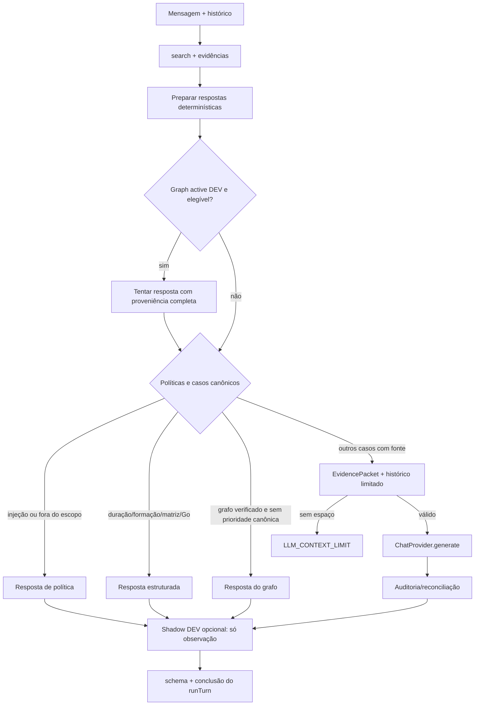

# `ChatService.execute` — algoritmo e precedência reais

[← Mapa do código](../mapa-do-codigo.md) · [Fluxo geral](../orbe-fluxo-de-resposta.md)

**Fonte:** [`apps/orbe-node/src/application/chat.ts`](../../../apps/orbe-node/src/application/chat.ts) (backend `main` `c302ec444266`). **Revisão estática:** documentação de código; nesta etapa não executamos uma conversa, LLM ou banco.

## Contrato do caso de uso

| Campo                  | Implementação                                                                                                                                |
| ---------------------- | -------------------------------------------------------------------------------------------------------------------------------------------- |
| Símbolo                | [`ChatService.execute`](../../../apps/orbe-node/src/application/chat.ts#L77-L546)                                                            |
| Entrada                | `ChatRequest`, `token?: string`, `{ meetingActions?, analyticsConsent? }`                                                                    |
| Saída                  | `Promise<ChatResponse>` validado por `chatResponseSchema`                                                                                    |
| Dependências injetadas | `ConversationStore`, `ChatProvider`, `KnowledgeRepository`, `Config`, relógio, Reader externo opcional, `GraphShadowPort`, `GraphActivePort` |
| Efeito durável         | Transação da `ConversationStore.runTurn`: nova conversa, par pergunta/resposta, atualização do histórico e eventual metadado agregado        |
| Segurança              | Hash de token, escopo profissional, verificação de fontes, bloqueio de injeção e orçamento de contexto/LLM                                   |

### Sequência detalhada com linhas e porquê

| Bloco                              | Linhas                                                               | Regra observada                                                                                                                                                  | Motivo e cuidado de manutenção                                      |
| ---------------------------------- | -------------------------------------------------------------------- | ---------------------------------------------------------------------------------------------------------------------------------------------------------------- | ------------------------------------------------------------------- |
| Criar/continuar conversa           | [77–94](../../../apps/orbe-node/src/application/chat.ts#L77-L94)     | Novo turno cria UUID e token aleatório; continuação exige token de formato correto; chama `store.runTurn` com hash                                               | ID sozinho não autoriza histórico                                   |
| Resolver elipses                   | [95–124](../../../apps/orbe-node/src/application/chat.ts#L95-L124)   | Detecta pergunta anterior relevante; `E com Go?` troca a tecnologia mantendo a intenção; outros follow-ups combinam contexto                                     | Não juntar habilidades antigas e novas como requisitos simultâneos  |
| Recuperar PPKS                     | [125–177](../../../apps/orbe-node/src/application/chat.ts#L125-L177) | `knowledge.search` com reforço a carreira cronológica, catálogo completo e períodos de experiência                                                               | Evitar perder vínculos importantes em ranking lexical Top-N         |
| Evidência externa opcional         | [178–193](../../../apps/orbe-node/src/application/chat.ts#L178-L193) | `PublicEvidenceReader.read` somente quando não é injeção/fora de escopo; referências externas são dados não confiáveis                                           | Nunca executar instruções da página consultada; leitura pode falhar |
| Evidências e respostas verificadas | [203–224](../../../apps/orbe-node/src/application/chat.ts#L203-L224) | Matriz, duração, histórico, resposta Go e dados acadêmicos preparados independentemente do modelo                                                                | Contagens e status profissionais não dependem de geração livre      |
| Candidato GraphRAG ativo           | [225–272](../../../apps/orbe-node/src/application/chat.ts#L225-L272) | Só quando `graphActive` está disponível, pergunta elegível e respostas canônicas especiais não se aplicam; usa orçamento compartilhado                           | A falha/abstenção do grafo não vira resposta falsa                  |
| Ordem de precedência               | [273–315](../../../apps/orbe-node/src/application/chat.ts#L273-L315) | Injeção, saudação, teste, fora de escopo, pessoal, experiência verificável, ausência de Go, reuniões indisponíveis, sem fontes, cursos, matriz, grafo, então LLM | Preservar essa ordem ao adicionar novas políticas                   |
| Montar contexto                    | [316–368](../../../apps/orbe-node/src/application/chat.ts#L316-L368) | Limita histórico; protege cobertura multi-requisito; usa `buildEvidencePacket`; sem espaço → `LLM_CONTEXT_LIMIT`                                                 | Não truncar silenciosamente competência pedida em uma vaga          |
| Invocar LLM                        | [369–414](../../../apps/orbe-node/src/application/chat.ts#L369-L414) | `provider.generate` com contexto, histórico, signal e timeout `LLM_TIMEOUT_MS`                                                                                   | Mesmo um provider com fallback pode falhar; não prometer resposta   |
| Auditar alegações                  | [415–472](../../../apps/orbe-node/src/application/chat.ts#L415-L472) | Auditoria grafo opcional para texto LLM; reconciliação acadêmica canônica e complementação de fontes                                                             | Não elevar curso a emprego nem graduação pendente a concluída       |
| Comparar Shadow                    | [473–509](../../../apps/orbe-node/src/application/chat.ts#L473-L509) | `graphShadow.inspect` apenas **após** produzir resposta, com telemetria sanitizada                                                                               | Shadow não modifica `answer`                                        |
| Validar e persistir                | [510–545](../../../apps/orbe-node/src/application/chat.ts#L510-L545) | `chatResponseSchema.parse`, `meta` e par de mensagens para `runTurn`                                                                                             | Metadata `deterministic` não é veredito de veracidade universal     |

## Diagrama de decisões — representa a precedência da seção central

**Precisão importante:** a execução real de `shadow` ocorre **antes** da montagem final do `chatResponseSchema`, mas **depois** da resposta ter sido definida. O diagrama representa ordem de decisão, não um trace literal de I/O com o banco.

## Exemplo concreto: Java → “E com o Go?”

- [`ellipticalTechnology`](../../../apps/orbe-node/src/application/technology-follow-up.ts#L12-L50) detecta uma elipse curta.
- [`rewriteEllipticalTechnologyQuestion`](../../../apps/orbe-node/src/application/technology-follow-up.ts#L52-L70) mantém a intenção anterior, sem adicionar duas tecnologias.
- [`buildDirectGoExperienceResponse`](../../../apps/orbe-node/src/application/go-experience-response.ts#L10-L71) só utiliza a resposta direta na ausência da respectiva evidência atual no catálogo; se Go vier a constar do conhecimento, a regra deixa o fluxo normal decidir.
- **Invariante:** não afirmar que existe experiência profissional em Go só porque Java é transferível.

## Exemplo: vários requisitos, orçamento pequeno

No trecho [`chat.ts:316–368`](../../../apps/orbe-node/src/application/chat.ts#L316-L368), vagas e comparações selecionam mais que os cinco documentos usuais. A função [`buildEvidencePacket`](../../../apps/orbe-node/src/application/evidence-packet.ts#L19-L167) tenta alocar orçamento preservando as tecnologias requisitadas; se não cabe o mínimo relevante, retorna `null` e a aplicação retorna erro controlado, não uma resposta com requisitos omitidos deliberadamente.

## Falhas e fronteiras

| Situação                                      | Tratamento do código                                    | Teste de referência                                                                                                                                |
| --------------------------------------------- | ------------------------------------------------------- | -------------------------------------------------------------------------------------------------------------------------------------------------- |
| Continuação sem token                         | `conversationNotFound`                                  | [`tests/http.test.ts`](../../../tests/http.test.ts)                                                                                                |
| Injeção ou vida pessoal                       | Resposta de política de escopo                          | [`tests/orbe-social-policy.test.ts`](../../../tests/orbe-social-policy.test.ts), [`tests/public-orbe.test.ts`](../../../tests/public-orbe.test.ts) |
| Erro/abstenção de `graphActive.answer`        | Continua caminho canônico                               | [`tests/graphrag-active-http.test.ts`](../../../tests/graphrag-active-http.test.ts)                                                                |
| Contexto sem documentos suficientes           | `LLM_CONTEXT_LIMIT` (502)                               | [`tests/evidence-packet.test.ts`](../../../tests/evidence-packet.test.ts), [`tests/context.test.ts`](../../../tests/context.test.ts)               |
| Timeout da geração                            | `LLM_TIMEOUT` (504)                                     | [`tests/http.test.ts`](../../../tests/http.test.ts)                                                                                                |
| Falha genérica de LLM                         | `LLM_UNAVAILABLE` (502), ressalvados `AppError` prévios | [`tests/llm-adapter.test.ts`](../../../tests/llm-adapter.test.ts)                                                                                  |
| Resposta acadêmica incorreta                  | Reconciliação canônica sob condições conservadoras      | [`tests/orbe-canonical-claims.test.ts`](../../../tests/orbe-canonical-claims.test.ts)                                                              |
| Resposta do grafo com proveniência incompleta | Abstém; não ultrapassa o limite de fontes               | [`tests/graph-public-policy.test.ts`](../../../tests/graph-public-policy.test.ts)                                                                  |

**Nota sobre testes:** a coluna aponta a testes com nome/escopo pertinente existentes na árvore; não afirma que cada linha de código esteja coberta, nem que eles foram executados durante esta documentação. Uma auditoria de cobertura por caso exige inspeção de assertions e execução controlada.

## Orientação para alterações futuras

Antes de alterar `ChatService.execute`, documentar qual política muda de precedência; adicionar teste de **caso positivo e contraexemplo**; verificar que a fonte continua vinculada à afirmação; observar limites `CHAT_CONTEXT_CHARS`, `CHAT_HISTORY_MESSAGES`, `LLM_TIMEOUT_MS`; executar os testes de recrutadores e revisar `shadow`/GraphRAG quando houver impacto. Para fatos profissionais, atualizar PPKS e catálogo, não improvisar um novo texto de prompt.
