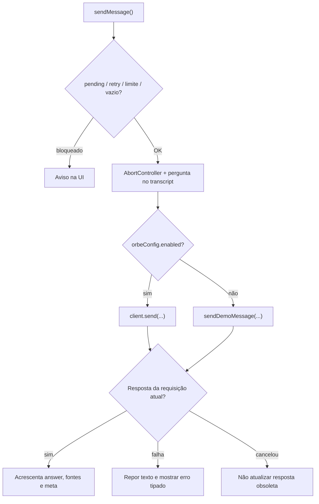

# Frontend em profundidade — rotas, hooks, chat e transições

[← Mapa](../mapa-do-codigo.md) · [Frontend — visão geral](../frontend.md) · [API e sessão](api-e-sessao.md)

**Repositório-base:** [`web-portfolio-v2`](https://github.com/SladeSouzaSantos/web-portfolio-v2), branch `main` `5514b5ac6626`. A branch `dev` tem ferramentas adicionais de teste live; não confundir isso com funcionalidade de produto.

## 1. Composição e roteamento

[`src/App.tsx`](https://github.com/SladeSouzaSantos/web-portfolio-v2/blob/main/src/App.tsx):

- `App` escolhe tema por `useTheme`, corrige título/meta-descrição conforme o caminho e monta `Routes`.
- `/` monta `PortfolioPage`, com `Navbar`, `useSectionNavigation`, `useSectionTransition`, seção ativa e `OrbAssistant`.
- `/projetos` monta `ArquivoProjetos`; rotas antigas redirecionam.
- `/administracao` **redireciona** para o portfólio. Os componentes antigos de administração/reuniões existem no Git, mas não são UI pública.
- A mudança de seção é conduzida pelo **hash**, sem reload de todo documento.

## 2. Estado e responsabilidades dos componentes

| Símbolo                                                                                                                              | Estado / entrada                              | Efeito / consequência                                                 |
| ------------------------------------------------------------------------------------------------------------------------------------ | --------------------------------------------- | --------------------------------------------------------------------- |
| [`PortfolioPage`](https://github.com/SladeSouzaSantos/web-portfolio-v2/blob/main/src/App.tsx#L20-L41)                                | Tema + seção extraída do hash                 | Renderiza uma seção, navbar, Orbe e overlay                           |
| [`OrbAssistant`](https://github.com/SladeSouzaSantos/web-portfolio-v2/blob/main/src/components/OrbAssistant.tsx#L17-L295)            | UI, `open`, `expanded`, refs de canvas/modal  | Abertura, teclado, fontes, mensagem, copiar/cancelar                  |
| [`useOrbeChat`](https://github.com/SladeSouzaSantos/web-portfolio-v2/blob/main/src/hooks/useOrbeChat.ts#L28-L199)                    | `messages`, `query`, `retryAt`, `reportOptIn` | Valida turno, chama cliente HTTP ou demo e atualiza UI                |
| [`createOrbeClient`](https://github.com/SladeSouzaSantos/web-portfolio-v2/blob/main/src/services/orbeClient.ts#L168-L335)            | URL + dependências opcionais                  | `send`, `reset`, `withdrawReport` com token em closure                |
| [`useSectionTransition`](https://github.com/SladeSouzaSantos/web-portfolio-v2/blob/main/src/hooks/useSectionTransition.tsx#L19-L132) | Seção ativa e evento de link                  | Círculo de cobertura e transição visual                               |
| [`useSectionNavigation`](https://github.com/SladeSouzaSantos/web-portfolio-v2/blob/main/src/hooks/useSectionNavigation.ts#L13-L19)   | Hash da localização                           | `SecaoId` corrente                                                    |
| [`getOrbeSources`](https://github.com/SladeSouzaSantos/web-portfolio-v2/blob/main/src/services/orbeSources.ts#L3-L21)                | Referências da API                            | Exibe links seguros; URLs não HTTP(S) não são tratadas como navegação |
| [`saveOrbeTranscript`](https://github.com/SladeSouzaSantos/web-portfolio-v2/blob/main/src/services/orbeTranscript.ts#L48-L70)        | Mensagens renderizáveis                       | Cache recente sem tokens de sessão                                    |

## 3. Ao apertar Enter, o que acontece?

[`OrbAssistant.tsx:96–105`](https://github.com/SladeSouzaSantos/web-portfolio-v2/blob/main/src/components/OrbAssistant.tsx#L96-L105) usa `handleComposerKeyDown`:

1. Se não é Enter, ou `Shift` está pressionado, deixa o navegador cuidar da edição.
2. Se há composição IME, evita envio acidental durante entrada de caracteres.
3. Para Enter válido, impede o newline padrão e solicita `form.requestSubmit()` quando não está carregando e não há cooldown.
4. O submit chama `useOrbeChat.sendMessage`; texto em branco, grande demais ou sessão ocupada não avançam.
5. A pergunta aparece imediatamente na UI, mas a resposta só é adicionada após resposta do cliente e checagem da requisição vigente.

## 4. `useOrbeChat.sendMessage`: estado do turno

Fonte: [`useOrbeChat.ts:111–168`](https://github.com/SladeSouzaSantos/web-portfolio-v2/blob/main/src/hooks/useOrbeChat.ts#L111-L168).

O `pendingRef` evita envios paralelos. Ao fechar o chat, a interface cancela a solicitação em aberto, mas **cancelar no navegador não garante cancelamento transacional do backend**. A UI avisa essa incerteza.

## 5. `createOrbeClient.send`: protocolo e cancelamento

Fonte: [`orbeClient.ts:168–307`](https://github.com/SladeSouzaSantos/web-portfolio-v2/blob/main/src/services/orbeClient.ts#L168-L307).

- Valida URL `http/https` sem credenciais embutidas, normaliza caminho da API.
- Rejeita mensagem acima de **2.000 unidades UTF-16** e payload acima de **8.192 bytes**, além de pedido concorrente.
- Para primeira pergunta envia somente `message`; com consentimento explícito e ainda sem sessão, `X-Orbe-Report-Consent: yes`.
- Em continuação envia `conversationId` no corpo e `X-Conversation-Token` no header.
- `fetch` usa `cache: 'no-store'`, `credentials: 'omit'`, `redirect: 'error'` e `AbortController`. O timeout default do cliente é **45 segundos**.
- Verifica shape da resposta e identidade da sessão; se a primeira resposta não fornece token ou a continuação fornece token inesperado/ID diferente, lança erro de protocolo.
- Expiração de sessão (HTTP 404) invalida a credencial. `reset` também invalida token e cancela request.

O cache de [`orbeTranscript.ts`](https://github.com/SladeSouzaSantos/web-portfolio-v2/blob/main/src/services/orbeTranscript.ts) **não restaura token**, apenas texto recente; essa distinção deve permanecer ao refatorar armazenamento local.

## 6. `useSectionTransition`: por que o portal circular não pisca?

Fonte: [`useSectionTransition.tsx:19–132`](https://github.com/SladeSouzaSantos/web-portfolio-v2/blob/main/src/hooks/useSectionTransition.tsx#L19-L132).

1. Preserva middle click e links modificados (Ctrl/Cmd/Shift/Alt).
2. Se `prefers-reduced-motion` está ativo, usa navegação imediata sem máscara animada.
3. Obtém coordenadas do item clicado e calcula círculo que pode cobrir o viewport.
4. Ativa máscara `clip-path` e um escudo que bloqueia cliques fora do círculo.
5. Começa antecipadamente `warmSectionScene(destination)`, sem exigir carregar GIF.
6. Anima **expansão 340 ms**, então navega via `flushSync` com hash da seção.
7. Espera no máximo **180 ms** pela decodificação WebP (ou oportunidade de paint) e anima **revelação 380 ms**.
8. Usa `runId` e cancelamento para impedir que navegações obsoletas deixem UI bloqueada; no erro, faz fallback à navegação solicitada.

Este hook não é o preloader inicial: [`sitePreloader.ts`](https://github.com/SladeSouzaSantos/web-portfolio-v2/blob/main/src/lib/sitePreloader.ts) gerencia a **primeira renderização**, em outro momento da experiência.

## 7. Conteúdo, acessibilidade e código histórico

- [`src/sections/Projetos.tsx`](https://github.com/SladeSouzaSantos/web-portfolio-v2/blob/main/src/sections/Projetos.tsx) e [`ArquivoProjetos.tsx`](https://github.com/SladeSouzaSantos/web-portfolio-v2/blob/main/src/sections/ArquivoProjetos.tsx) reutilizam catálogos e componentes de missão.
- [`Formacao.tsx`](https://github.com/SladeSouzaSantos/web-portfolio-v2/blob/main/src/sections/Formacao.tsx) monta fichas/trilhas e modal de detalhes; os dados visuais precisam refletir o catálogo canônico de formação.
- `AdminDashboard`, `AuthContext`, `MeetingsContext` e componentes de reunião são **históricos** no estado público; a presença dos arquivos não habilita interface.
- Navegação e modal precisam de teclado, foco visível e `prefers-reduced-motion` adequados.

## 8. Testes para alteração de cada fluxo

| Área                          | Arquivos                                                                                                                                                                                                                                                             |
| ----------------------------- | -------------------------------------------------------------------------------------------------------------------------------------------------------------------------------------------------------------------------------------------------------------------- |
| Chat e respostas do cliente   | [`tests/orbe-client.spec.ts`](https://github.com/SladeSouzaSantos/web-portfolio-v2/blob/main/tests/orbe-client.spec.ts), [`tests/orbe-public.spec.ts`](https://github.com/SladeSouzaSantos/web-portfolio-v2/blob/main/tests/orbe-public.spec.ts)                     |
| Navegação e transição         | [`tests/routing.spec.ts`](https://github.com/SladeSouzaSantos/web-portfolio-v2/blob/main/tests/routing.spec.ts), [`tests/section-circle-transition.spec.ts`](https://github.com/SladeSouzaSantos/web-portfolio-v2/blob/main/tests/section-circle-transition.spec.ts) |
| Carregamento inicial          | [`tests/site-loading.spec.ts`](https://github.com/SladeSouzaSantos/web-portfolio-v2/blob/main/tests/site-loading.spec.ts)                                                                                                                                            |
| Projetos/mídia                | [`tests/project-gallery.spec.ts`](https://github.com/SladeSouzaSantos/web-portfolio-v2/blob/main/tests/project-gallery.spec.ts), [`tests/archive-layout.spec.ts`](https://github.com/SladeSouzaSantos/web-portfolio-v2/blob/main/tests/archive-layout.spec.ts)       |
| Formação                      | [`tests/formacao-cursos.spec.ts`](https://github.com/SladeSouzaSantos/web-portfolio-v2/blob/main/tests/formacao-cursos.spec.ts)                                                                                                                                      |
| Acessibilidade/responsividade | [`tests/accessibility.spec.ts`](https://github.com/SladeSouzaSantos/web-portfolio-v2/blob/main/tests/accessibility.spec.ts), [`tests/responsive.spec.ts`](https://github.com/SladeSouzaSantos/web-portfolio-v2/blob/main/tests/responsive.spec.ts)                   |

**Sem deploy nesta documentação:** as explicações foram extraídas da leitura de fonte `main`, não de inspeção do DOM/servidor publicado neste turno. Para validar DEV live, seguir o [guia específico](https://github.com/SladeSouzaSantos/web-portfolio-v2/blob/dev/docs/ORBE-LIVE-PLAYWRIGHT-DEV.md).
