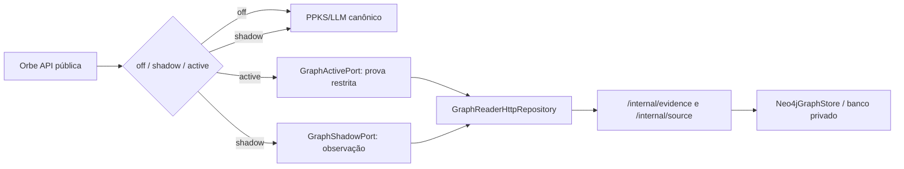

# GraphRAG — snapshot PPKS, Neo4j, Graph Reader e modos de resposta

[← Mapa](../mapa-do-codigo.md) · [PPKS](ppks-e-recuperacao.md) · [ChatService](chatservice.md)

**Estado:** código GraphRAG presente na base `main`, porém o [bootstrap](../../../apps/orbe-node/src/main.ts) usa `ORBE_GRAPHRAG_MODE=off` como padrão. Os modos `shadow` e `active` exigem autorização **DEV-only**, overlays e Reader privado. A existência destes arquivos **não significa** que estejam habilitados no MiniMac.

## 1. Topologia lógica e isolamento

A API pública **não** deveria deter credenciais de Neo4j. O [`assertPublicOrbeGraphIsolation`](../../../apps/orbe-node/src/application/graph-public-policy.ts#L67-L80) rejeita variáveis proibidas para a API pública. O processo Reader recebe segredos em separado e só publica endpoints de consulta de evidências.

## 2. Do arquivo PPKS ao Neo4j

| Componente                                                                                          | Responsabilidade                                                       |
| --------------------------------------------------------------------------------------------------- | ---------------------------------------------------------------------- |
| [`projectPpksEvidenceGraph`](../../../apps/orbe-node/src/adapters/ppks-evidence-graph.ts#L118-L291) | Converte fichas e cursos em snapshot com nodes, relações e `sourceIds` |
| [`evidenceGraphSnapshotSchema`](../../../apps/orbe-node/src/domain/evidence-graph.ts#L148-L217)     | Rejeita duplicidade, IDs pendentes e ausência de fontes válidas        |
| [`planNeo4jGraphSeed`](../../../apps/orbe-node/src/adapters/neo4j-graph-queries.ts#L55-L89)         | Gera plano determinístico de escrita/limpeza e hash de snapshot        |
| [`Neo4jGraphStore.seed`](../../../apps/orbe-node/src/adapters/neo4j-driver-store.ts#L84-L110)       | Executa plano Cypher usando driver/conta privados                      |
| [`Neo4jEvidenceRepository`](../../../apps/orbe-node/src/adapters/neo4j-graph-queries.ts#L123-L169)  | Expõe `findEvidence` e `getSource` por consultas aprovadas             |

O [`Neo4jGraphStore.read`](../../../apps/orbe-node/src/adapters/neo4j-driver-store.ts#L53-L83) aceita apenas queries pertencentes à allowlist. Não é uma API para executar Cypher arbitrário do visitante. O plano de seed gera os nós, relações, poda elementos de snapshots antigos, mas as **fichas versionadas** seguem fonte de verdade.

## 3. Graph Reader — serviço com menos privilégios

[`buildInternalGraphReader`](../../../apps/orbe-node/src/graph-reader/app.ts#L33-L95) monta Fastify privado:

| Endpoint                  | Entrada                                      | Saída              | Limites                                           |
| ------------------------- | -------------------------------------------- | ------------------ | ------------------------------------------------- |
| `GET /internal/health`    | Bearer interno                               | `{status:'ready'}` | Check do processo Reader                          |
| `POST /internal/evidence` | `{ requirements, maxClaimsPerRequirement? }` | `{matches}`        | Zod estrito, IDs distintos, 1–20 claims/requisito |
| `POST /internal/source`   | `{ id }`                                     | `{source: ...      | null}`                                            | ID validado, fonte pública filtrada |

O Reader autentica `Authorization: Bearer …` com fingerprint SHA-256 e comparação de tempo constante; limita body, timeout e taxa. **Não oferece endpoint de escrita, consultas Cypher livres ou administração**. Suas respostas passam por [`PublicGraphEvidenceGateway`](../../../apps/orbe-node/src/application/graph-public-policy.ts#L16-L65).

O [cliente não privilegiado](../../../apps/orbe-node/src/adapters/graph-reader-http.ts#L44-L151) fixa o destino do serviço, usa timeout/limites de bytes, valida Zod e recusa resultado com fontes não públicas, duplicadas ou referências faltantes. A API externa não recebe a senha Bolt.

## 4. `shadow`: observação sem substituir resposta

[`createGraphRagShadow`](../../../apps/orbe-node/src/application/graph-rag-shadow.ts#L33-L62) compõe identificador de requisitos e verificação de prévia. O [`ChatService`](../../../apps/orbe-node/src/application/chat.ts#L473-L509) o chama **depois de escolher a resposta canônica** e registra só `mode`, razão, contagens, tempo e trace ID sanitizado.

- Uma falha no Reader gera evento de observação em erro.
- A resposta `answer` e as fontes devolvidas **não** são substituídas pelo experimento shadow.
- **Testar shadow não significa testar `active` nem aprovar qualidade semântica.**

## 5. `active`: exigência de cobertura e fonte pública completa

[`createGraphRagActive`](../../../apps/orbe-node/src/application/graph-active-answer.ts#L92-L222) é o caminho de grafo elegível:

1. Usa catálogo/snapshot PPKS para identificar tecnologia ou requisitos.
2. Para vaga, usa [`createCoverageAwareVacancyPlanner`](../../../apps/orbe-node/src/application/graph-vacancy-coverage.ts#L228-L255). Se o texto tiver cláusulas não compreendidas, abstém, sem descartar requisitos silenciosamente.
3. Opcionalmente usa [`createBudgetedSemanticVacancyProposer`](../../../apps/orbe-node/src/application/graph-semantic-vacancy.ts#L56-L127) **uma vez** para normalizar labels desconhecidas; exige que o plano validado seja mais completo, sem fabricar competências. O limite lógico de chamada é compartilhado com o turno.
4. Recupera claims e exige **todas as fontes da claim**, públicas e com URL HTTPS; escopo `unknown` não é elegível.
5. Chama [`evaluateGraphRecruiterPreview`](../../../apps/orbe-node/src/application/graph-recruiter-preview.ts#L51-L190). Só resultado `verified_graph` com fontes retorna resposta; mais de dez fontes ou proveniência incompleta provoca abstenção.
6. Se o caminho de grafo abstiver/falhar, [`ChatService`](../../../apps/orbe-node/src/application/chat.ts#L225-L315) segue **uma vez** pelo processo canônico PPKS/LLM.

Não usar `active` em perguntas fora de escopo, injeção, curso completo e duração já verificável — regras anteriores continuam prioritárias.

## 6. Auditoria de prosa e limites

O método [`auditGeneratedRecruiterProse`](../../../apps/orbe-node/src/application/graph-generated-prose-audit.ts#L86-L309) examina afirmações geradas comparando snapshot e fontes, com limite explícito de escopo. **Não é prova universal de factualidade para qualquer resposta LLM.** O `ChatService` aplica correções acadêmicas conservadoras quando couber.

### O que GraphRAG **não** faz

- Não garante que link de vaga LinkedIn seja acessível — Reader externo é separado.
- Não comprova competência só pela existência de uma aresta.
- Não substitui PPKS como fonte da verdade.
- Não ativa Neo4j na produção só porque `neo4j-driver` está instalado.
- Não executa uma comparação de performance de infraestrutura automaticamente.

## 7. Segurança de configuração e testes

Configuração DEV documentada em [`docs/graph-rag-active-dev.md`](../../graph-rag-active-dev.md) exige flags explícitas, aprovação, secret Reader e overlay próprio. `NODE_ENV=production` não diferencia um checkout DEV de MAIN, portanto **não** serve como prova de ambiente. O pipeline deve confirmar digest, readiness, Reader privado e proveniência das fontes antes de promoção.

Testes pertinentes:

- [`graph-reader-http-client.test.ts`](../../../tests/graph-reader-http-client.test.ts), [`graph-reader-http.test.ts`](../../../tests/graph-reader-http.test.ts)
- [`neo4j-graph-queries.test.ts`](../../../tests/neo4j-graph-queries.test.ts), [`neo4j.integration.test.ts`](../../../tests/neo4j.integration.test.ts)
- [`graphrag-active-http.test.ts`](../../../tests/graphrag-active-http.test.ts), [`graphrag-shadow-http.test.ts`](../../../tests/graphrag-shadow-http.test.ts)
- [`graph-public-policy.test.ts`](../../../tests/graph-public-policy.test.ts), [`graph-vacancy-coverage.test.ts`](../../../tests/graph-vacancy-coverage.test.ts)

**Nota experimental:** a investigação HydraDB encontra-se na branch [`experiment/hydradb`](https://github.com/SladeSouzaSantos/phasscode-platform/tree/experiment/hydradb). Ela **não** está incorporada a DEV/MAIN e não é apresentada como substituto homologado de Neo4j.
