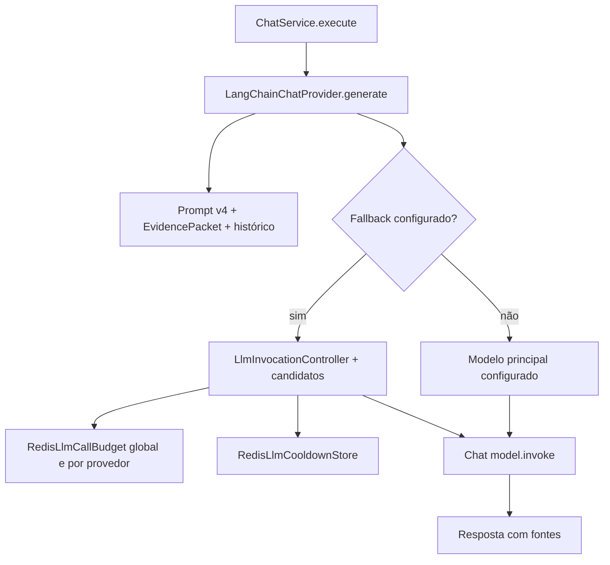

# LLM — construção da resposta, quota, fallback e cooldown

[← Mapa](../mapa-do-codigo.md) · [ChatService](chatservice.md) · [Segurança](../qualidade-e-seguranca.md)

## 1. Separação de responsabilidades



O código foi dividido para permitir **trocar provedores sem reescrever as regras profissionais do Orbe**. A porta de aplicação é [`ChatProvider`](../../../apps/orbe-node/src/domain/ports.ts#L88-L91). O modelo não deve escolher URLs internas, credenciais, disponibilidade profissional nem quais fatos serão considerados verdadeiros.

## 2. Mapa de funções

| Fonte                                                                                                    | Função/contrato                      | O que controla                                                                                      |
| -------------------------------------------------------------------------------------------------------- | ------------------------------------ | --------------------------------------------------------------------------------------------------- |
| [`main.ts`](../../../apps/orbe-node/src/main.ts#L81-L121)                                                | Composição das dependências          | Seleciona `mock` ou `LangChainChatProvider`, cria orçamento Redis e fallback opt-in                 |
| [`LangChainChatProvider.generate`](../../../apps/orbe-node/src/adapters/langchain-provider.ts#L89-L455)  | `GenerationInput → GenerationResult` | Montagem de mensagens, invocação, ferramentas/rounds e extração de fontes                           |
| [`prompt v4`](../../../apps/orbe-node/prompts/v4.md)                                                     | Instruções da persona/escopo         | Apresentar com evidências, respeitando limites                                                      |
| [`createFallbackInvocationFactory`](../../../apps/orbe-node/src/adapters/fallback-llm.ts#L41-L109)       | Gerador de invocações por turno      | Vários candidatos, tentativa, quotas e cooldown                                                     |
| [`createRedisFallbackInvocationFactory`](../../../apps/orbe-node/src/adapters/fallback-llm.ts#L113-L164) | Fallback real                        | Cria identidades Redis por provedor sem incluir credenciais em texto aberto                         |
| [`LlmInvocationController`](../../../apps/orbe-node/src/adapters/llm-invocation-controller.ts#L196-L395) | Estado de tentativas                 | Limita tentativas e classifica falhas/transitórios                                                  |
| [`RedisLlmCallBudget.reserve`](../../../apps/orbe-node/src/adapters/redis-llm-budget.ts#L68-L100)        | Reserva global/provedor              | Impede invocações acima do limite; sem reembolso                                                    |
| [`graph-turn-llm-budget.ts`](../../../apps/orbe-node/src/application/graph-turn-llm-budget.ts)           | Orçamento lógico compartilhado       | Quando `active` DEV, normalização semântica e resposta não devem ultrapassar limites do mesmo turno |

## 3. Redis: como funciona a janela de chamadas

O script Lua em [`redis-llm-budget.ts:10–41`](../../../apps/orbe-node/src/adapters/redis-llm-budget.ts#L10-L41) realiza atomicamente:

1. Consulta o horário do **próprio Redis** (`TIME`).
2. Se a chave não existe, cria `count=1`, `resetAt`, `limit` e `window`, com expiração no mesmo instante final.
3. Se a chave existe, valida consistência de contagem, janela e prazo. Metadados incompatíveis **não** viram créditos novos.
4. Se o teto já foi alcançado, retorna `[0, retryAfter]`.
5. Caso contrário incrementa `count` por `HINCRBY` e aceita a reserva.

`reserve()` transforma saída de limite em **`LLM_BUDGET_EXHAUSTED` 429**, com `Retry-After`; se Redis falha, a resposta é **`LLM_BUDGET_UNAVAILABLE` 503**, sem chamar o modelo. Uma reserva **não é reembolsada** quando a chamada depois falha. Isso é um **contador de invocações, não medição de tokens, dinheiro ou saldo do provedor**.

## 4. O fallback não é retry ilimitado

[`createFallbackInvocationFactory`](../../../apps/orbe-node/src/adapters/fallback-llm.ts#L41-L109) cria um `turn` para uma sequência de candidatos. Antes de **cada tentativa**:

- Garante que o sinal não foi cancelado.
- Verifica tamanho de contexto do modelo/candidato, podendo produzir `LLM_CONTEXT_LIMIT`.
- Reserva o orçamento **específico do provedor**. Quota individual esgotada pode selecionar outro candidato; erros de Redis não são tratados como autorização para avançar.
- Reserva também o orçamento **global**. Falha global interrompe antes de qualquer chamada externa.
- Só então chama o modelo via `invoke(messages, signal)`.

O [`LlmInvocationController`](../../../apps/orbe-node/src/adapters/llm-invocation-controller.ts) gerencia classificação de falhas, `maxAttemptsPerTurn`, cooldown e diagnósticos. A classificação só cobre o que o adapter consegue reconhecer; não garante que um provedor disponível tenha qualidade factual.

## 5. Geração e resposta profissional

O [`ChatService.execute`](../../../apps/orbe-node/src/application/chat.ts#L273-L472) primeiro oferece caminhos determinísticos e verificações. **A LLM recebe apenas o orçamento de documentos que coube**, com contexto de conversa limitado. Após a geração, o Orbe pode corrigir alegações acadêmicas específicas e realizar auditoria de afirmações em modo grafo, acrescentando fontes apropriadas.

```text
Input normalizado
  → documentos PPKS + contexto/histórico
  → seleção limitada por orçamento
  → prompt v4 e provider
  → eventual fallback entre modelos
  → auditoria de afirmações / reconciliação
  → ChatResponse com fontes e metadados
```

A presença de uma referência **não prova automaticamente cada frase gerada**; para qualidade exige-se teste de relevância, revisão humana e avaliação de fontes.

## 6. Erros e ações de manutenção

| Erro                           | Significado no fluxo                              | Conduta recomendada                                               |
| ------------------------------ | ------------------------------------------------- | ----------------------------------------------------------------- |
| `LLM_CONTEXT_LIMIT` / 502      | Documentos/contexto excederam limite ou não cabem | Melhorar seleção; não aumentar artificialmente memória sem testes |
| `LLM_TIMEOUT` / 504            | Prazo da geração estourou no serviço de chat      | Verificar modelo, filas e duração sem registrar prompt            |
| `LLM_UNAVAILABLE` / 502        | Falha não tipada de provedor/geração              | Validar upstream e fallback                                       |
| `LLM_BUDGET_EXHAUSTED` / 429   | Contador global chegou ao teto                    | Respeitar `Retry-After`; não zerar quotas para contornar          |
| `LLM_BUDGET_UNAVAILABLE` / 503 | Redis ou estado inconsistente                     | Resolver dependência; não chamar modelo sem proteção              |
| Cooldown por provedor          | Candidato temporariamente bloqueado               | Não confundir com expiração da quota global                       |

## 7. Testes associados (referências, não evidência de execução)

[`tests/llm-budget.test.ts`](../../../tests/llm-budget.test.ts), [`tests/llm-budget.integration.test.ts`](../../../tests/llm-budget.integration.test.ts), [`tests/llm-fallback.test.ts`](../../../tests/llm-fallback.test.ts), [`tests/llm-fallback.integration.test.ts`](../../../tests/llm-fallback.integration.test.ts), [`tests/llm-invocation-controller.test.ts`](../../../tests/llm-invocation-controller.test.ts), [`tests/llm-model-factory.test.ts`](../../../tests/llm-model-factory.test.ts), [`tests/graph-turn-llm-budget.test.ts`](../../../tests/graph-turn-llm-budget.test.ts), [`tests/llm-privacy.test.ts`](../../../tests/llm-privacy.test.ts).

**Regra para mudanças:** documentar ordem de seleção de provedores, política de quota e erros públicos; manter credenciais fora de frontend/logs; adicionar teste de exaustão, falha Redis e cancelamento. LLM gratuito é uma limitação operacional a ser medida, não justificativa para inferir experiência sem evidência.
