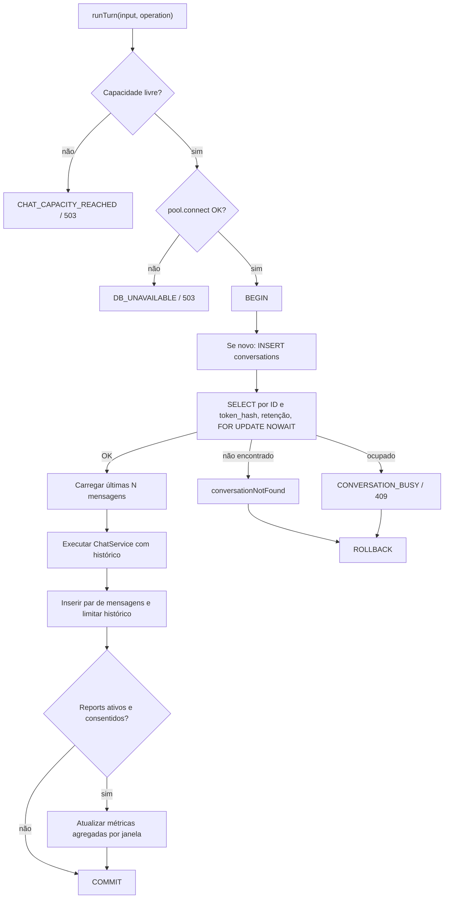

# Persistência, concorrência e relatórios opt-in

[← Mapa](../mapa-do-codigo.md) · [API/sessão](api-e-sessao.md) · [LLM](llm-e-orcamento.md)

## Componentes responsáveis

| Símbolo | Contrato | Efeito |
| --- | --- | --- |
| [`ConversationStore.runTurn`](../../../apps/orbe-node/src/domain/ports.ts#L96-L105) | `input`, callback async com histórico → `ChatResponse` | Define atomicidade do turno para implementação |
| [`PostgresConversationStore`](../../../apps/orbe-node/src/adapters/postgres-store.ts#L11-L175) | Store concreta de produção | Tabelas `conversations`, `conversation_messages`, reports opcionais |
| [`MemoryConversationStore`](../../../apps/orbe-node/src/adapters/memory-store.ts#L11-L54) | Store de teste/desenvolvimento | Dados em memória e perda no reinício |
| [`classifyInteraction`](../../../apps/orbe-node/src/application/report-classification.ts#L18-L32) | Classificação por padrões fixos | Categorias/intenção **sem persistir texto livre de relatório** |
| [`report-node`](../../../apps/report-node/src/main.ts) | Processo independente configurável | Envio de relatórios agregados ao Telegram |

## Algoritmo de `PostgresConversationStore.runTurn`

Fonte: [`postgres-store.ts:18–140`](../../../apps/orbe-node/src/adapters/postgres-store.ts#L18-L140).

### Notas de implementação relevantes

1. **Admissão por pool:** um `WeakMap<pg.Pool,{active}>` registra turnos ativos; a capacidade usa `max(1, pool.max - 2)`, reservando conexões no pool padrão de dez. Não é fila distribuída de tarefas. [Linhas 8–37](../../../apps/orbe-node/src/adapters/postgres-store.ts#L8-L37).
2. **Erro de conexão:** falha ao obter cliente do pool vira `DB_UNAVAILABLE/503`, com sugestão de aguardar. [Linhas 38–49](../../../apps/orbe-node/src/adapters/postgres-store.ts#L38-L49).
3. **Controle de acesso:** seleção exige `id`, `token_hash` e conversa atualizada dentro de `retentionDays`. O hash é conferido por comparação segura. [Linhas 50–66](../../../apps/orbe-node/src/adapters/postgres-store.ts#L50-L66).
4. **Exclusão mútua:** `FOR UPDATE NOWAIT` sinaliza disputa com código PostgreSQL `55P03` e gera `CONVERSATION_BUSY/409`. Não afrouxar esse controle para permitir turnos simultâneos no mesmo histórico.
5. **Transação longa intencional:** a callback de geração é aguardada dentro de `BEGIN` e antes de `COMMIT`. Isso conserva atomicidade simples mas ocupa uma conexão durante a geração. Não substituir por transações curtas sem desenhar lease/versão de turno. [Linhas 67–81](../../../apps/orbe-node/src/adapters/postgres-store.ts#L67-L81).
6. **Retenção local do histórico:** mantém somente `maxMessages` recentes após inserir ambos os lados da conversa. Isso não equivale à limpeza de conversas antigas: [`packages/database/src/retention.ts`](../../../packages/database/src/retention.ts) trata retenção periódica separadamente.
7. **Rollback e liberação:** toda falha tenta `ROLLBACK`; `finally` libera conexão e decrementa contador de admissão. [Linhas 122–140](../../../apps/orbe-node/src/adapters/postgres-store.ts#L122-L140).

## Retenção, consentimento e relatórios

A store recebe `reportsEnabled`; ela **só** atualiza relatório quando a funcionalidade está ativa e o visitante optou pela coleta (no início) e ainda não retirou o consentimento. [Linhas 82–121](../../../apps/orbe-node/src/adapters/postgres-store.ts#L82-L121).

A primeira pergunta com `analyticsConsent` pode ativar o opt-in; cada turno posterior elegível incrementa o contador de uma **janela de 24h relativa à criação da conversa**, salva tópicos em lista controlada, projetos por IDs públicos válidos e intenção `geral | recrutamento | contato`. O texto da mensagem é usado em memória na classificação, **não armazenado como transcrição na tabela de relatório**.

### Relatório não é worker antigo

No processo [`apps/report-node/src/main.ts`](../../../apps/report-node/src/main.ts), os passos documentados são `configFrom` → `claim` → `format`/resumo → `notify` (Telegram) → `mark` (resultado, tentativas e locks). O processo é opcional, separado do `apps/worker-node/` desativado no Orbe público.

- [`claim`](../../../apps/report-node/src/main.ts#L60-L113) usa reserva/lease para impedir concorrência simples.
- [`mark`](../../../apps/report-node/src/main.ts#L114-L140) registra sucesso/falha e libera locks.
- [`dailyText`](../../../apps/report-node/src/main.ts#L141-L168) consolida números do dia.
- [`notify`](../../../apps/report-node/src/main.ts#L27-L46) envia texto ao Telegram, sem garantia de exatamente uma entrega na janela entre entrega externa e confirmação no banco.
- [`report-format.ts`](../../../apps/report-node/src/report-format.ts) usa formato de fuso `America/Fortaleza` para os resumos.

O [endpoint opt-out](../../../apps/orbe-node/src/http/app.ts#L327-L354) exige ID + token e chama [`withdrawReport`](../../../apps/orbe-node/src/adapters/postgres-store.ts#L141-L163), que marca `reports_opted_out` e remove relatórios pendentes da conversa.

**Nunca inferir que revogar apagou relatórios já enviados ao Telegram.** Para entender limitações e cronogramas, consulte o [README backend](../../../README.md) e [testes de relatório](../../../tests/orbe-reports.test.ts).

## Tabela de estados de erro

| Etapa | Código público | Efeito esperado |
| --- | --- | --- |
| Sem capacidade do pool | `CHAT_CAPACITY_REACHED` / 503 | Turno recusado antes de reservar conexão |
| Banco inacessível | `DB_UNAVAILABLE` / 503 | Falha fechada |
| Mesmo histórico em processamento | `CONVERSATION_BUSY` / 409 | Transação concorrente recuada |
| Token/ID inválido ou expirado | Conversa não encontrada | Não revelar existência do histórico |
| Falha da callback/geração | Erro upstream ou aplicação | `ROLLBACK` antes de liberar client |

## Testes a consultar

[`postgres.integration.test.ts`](../../../tests/postgres.integration.test.ts), [`postgres-admission.test.ts`](../../../tests/postgres-admission.test.ts), [`orbe-reports.test.ts`](../../../tests/orbe-reports.test.ts), [`reports.integration.test.ts`](../../../tests/reports.integration.test.ts), [`public-orbe.test.ts`](../../../tests/public-orbe.test.ts).

**Limite desta documentação:** mapeamos as funções e instruções SQL visíveis, mas não fizemos EXPLAIN dos índices, auditoria das migrations ou teste de concorrência nesta rodada. O desenho real de tabelas deve sempre ser conferido em [`packages/database/`](../../../packages/database/) e migrations de cada ambiente.
