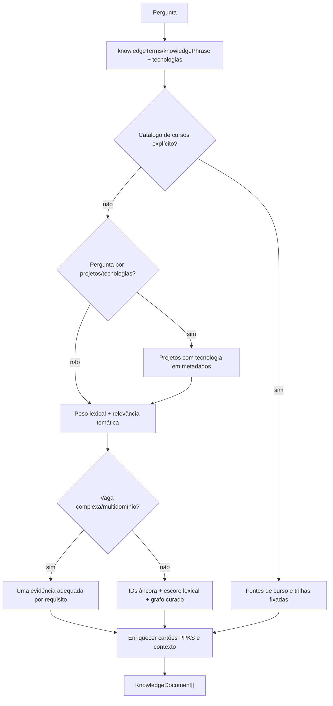

# PPKS e recuperação — lexical, regras de cobertura e grafo curado

[← Mapa](../mapa-do-codigo.md) · [ChatService](chatservice.md) · [GraphRAG](graphrag-e-reader.md)

## 1. Fonte canônica e três camadas de representação

| Dado                   | Fonte principal                                                                                     | Uso                                                          |
| ---------------------- | --------------------------------------------------------------------------------------------------- | ------------------------------------------------------------ |
| Catálogo profissional  | [`knowledge/portfolio.json`](../../../knowledge/portfolio.json)                                     | Documentos públicos que o Orbe pesquisa e cita               |
| Fichas PPKS            | [`knowledge/ppks/`](../../../knowledge/ppks/)                                                       | Prova por projeto, experiência, cursos, tecnologias e status |
| Relações conceituais   | [`knowledge/ppks/semantic-relations.json`](../../../knowledge/ppks/semantic-relations.json)         | Sugestão conservadora de documentos relacionados             |
| Snapshot de evidências | [`projectPpksEvidenceGraph`](../../../apps/orbe-node/src/adapters/ppks-evidence-graph.ts#L118-L291) | Grafo tipado e reconstituível para GraphRAG opt-in           |

**A fonte de verdade é o conteúdo PPKS versionado, não o Neo4j, o HydraDB ou a resposta gerada pela LLM.** O adaptador pode indexar ou recuperar, mas uma relação semântica por si só não prova emprego, formação concluída ou domínio de tecnologia.

## 2. `JsonKnowledgeRepository.load` — inicialização

[`knowledge.ts:165–182`](../../../apps/orbe-node/src/adapters/knowledge.ts#L165-L182):

1. Lê e valida JSON via Zod.
2. Rejeita IDs duplicados e referências a projetos inexistentes.
3. Para o caminho canônico, carrega cartões PPKS, evidências acadêmicas e cartões de experiência.
4. Inicializa `SemanticKnowledgeGraph.load(academic.skills)` quando há dados acadêmicos.
5. Devolve `JsonKnowledgeRepository` que implementa [`KnowledgeRepository`](../../../apps/orbe-node/src/domain/ports.ts#L59-L69).

Essa fase **não envia prompt a LLM** e não comprova automaticamente que as fichas foram reanalisadas a cada push.

## 3. `search(query)` — lógica e prioridades

A função [`JsonKnowledgeRepository.search`](../../../apps/orbe-node/src/adapters/knowledge.ts#L209-L685) não é apenas um `string.includes`. Ela combina caminhos específicos e ranqueamento geral:

O fluxograma é simplificado: há retornos antecipados para respostas acadêmicas, overview de carreira e perguntas específicas de projetos. O **retorno final** do caminho genérico limita a cinco documentos; a lógica especial de **vaga complexa** retorna conjunto que preserve requisitos sem impor esse teto ([`knowledge.ts:527–646`](../../../apps/orbe-node/src/adapters/knowledge.ts#L527-L646)). O `ChatService` decide posteriormente como caber no contexto da LLM.

### Ranking lexical

[`knowledge.ts:313–417`](../../../apps/orbe-node/src/adapters/knowledge.ts#L313-L417) constrói sets de termos por título, keywords e conteúdo; pondera especificidade (inclui frequência relativa dos termos) e multiplica importância: título × 3, keywords × 2 e conteúdo × 1, mais bônus de correspondência/relevância. `score` é ranking de documentos, **não probabilidade calibrada de experiência profissional**.

### Âncoras profissionais

[`knowledge.ts:419–524`](../../../apps/orbe-node/src/adapters/knowledge.ts#L419-L524) define IDs de evidência para perguntas típicas (Java → SIGAA/Spring/JPA; React → portfólio; Python → HSP; Flutter → Greencity). Esses anchors são identificadores curados, não uma busca online ou scraping em cada pergunta.

### Cobertura de múltiplos requisitos

[`knowledge.ts:527–646`](../../../apps/orbe-node/src/adapters/knowledge.ts#L527-L646) separa requisitos de linguagem, CI/CD, testes, graduação e idioma. Busca candidatos no catálogo público/sanitizado, prioriza evidência de trabalho e **não troca automaticamente MySQL por SQL Server**, Angular por React, ou projeto pessoal por emprego. Para tecnologias e requisitos reconhecidos, retém documentos distintos quando necessário.

Se o requisito desconhecido não tem prova no índice, o algoritmo volta ao ranking comum e não inventa evidência; cabe à resposta indicar o limite.

## 4. O grafo semântico pequeno

[`SemanticKnowledgeGraph`](../../../apps/orbe-node/src/adapters/semantic-graph.ts) carrega nodes/edges com Zod, aliases e relações de conceito.

- `matches(query)`: localiza aliases explícitos na frase normalizada.
- `directSources(node, documents)`: retorna **fontes documentadas**, não inferidas apenas da aresta.
- `evidenceIds(query)`: produz IDs elegíveis para priorização de documentos.
- `describe(query, documents)`: acrescenta contexto semântico limitado ao catálogo.

Não confundir isto com **Neo4j/GraphRAG**: o arquivo de relações semânticas é um índice curado local, enquanto o Neo4j é a projeção opcional de afirmações e fontes.

## 5. Snapshot PPKS de evidências — estrutura validável

[`projectPpksEvidenceGraph`](../../../apps/orbe-node/src/adapters/ppks-evidence-graph.ts#L118-L291) cria nodes como `candidate`, `company`, `engagement`, `project`, `skill`, `course`, `degree`, `claim` e `source`. Relacionamentos e claims mantêm `sourceIds`.

[`evidenceGraphSnapshotSchema`](../../../apps/orbe-node/src/domain/evidence-graph.ts#L148-L217) rejeita ID duplicado, fonte ausente, relações pendentes, claim com ponta inexistente ou vínculo mal tipado. A incompatibilidade entre `exclusive` e papel simultâneo de engenharia também é checada.

### Exemplo de comportamento correto

Uma evidência documenta Java em um vínculo profissional e SQL em outro. O Orbe pode explicar que ambos demonstram fundamentos de backend e integração, mas **não deve afirmar** anos de experiência profissional simultâneos com Java+SQL Server, muito menos converter experiência de Java em domínio de Go.

## 6. Orçamento e recorte dos documentos

Depois do ranking, [`buildEvidencePacket`](../../../apps/orbe-node/src/application/evidence-packet.ts#L19-L167) recebe fontes e `totalContentChars`. O algoritmo:

1. Calcula mínimos por documento para não sumir com uma competência pedida.
2. Reserva começos de fontes e redistribui a capacidade restante.
3. Com pressão severa, preserva assinatura de stack explícita e nomes completos de cursos, **sem inferir tecnologia nova**.
4. Retorna `null` quando o orçamento não comporta as evidências mínimas, permitindo a falha controlada `LLM_CONTEXT_LIMIT`.

**Não** “resolver” esse caso simplesmente descartando as últimas tecnologias requisitadas por uma vaga.

## 7. Testes e atualização

| Regra                         | Teste de referência existente                                                                                                                              |
| ----------------------------- | ---------------------------------------------------------------------------------------------------------------------------------------------------------- |
| Relevância e fontes           | [`knowledge-relevance.test.ts`](../../../tests/knowledge-relevance.test.ts)                                                                                |
| Alias e grafo curado          | [`semantic-graph.test.ts`](../../../tests/semantic-graph.test.ts)                                                                                          |
| PPKS e índices                | [`ppks.test.ts`](../../../tests/ppks.test.ts)                                                                                                              |
| Snapshot de evidência         | [`ppks-evidence-graph.test.ts`](../../../tests/ppks-evidence-graph.test.ts)                                                                                |
| Contexto de muitos requisitos | [`evidence-packet.test.ts`](../../../tests/evidence-packet.test.ts), [`recruiter-matrix.test.ts`](../../../tests/recruiter-matrix.test.ts)                 |
| Formação                      | [`ppks-academic.test.ts`](../../../tests/ppks-academic.test.ts), [`orbe-academic-completeness.test.ts`](../../../tests/orbe-academic-completeness.test.ts) |
| Questões de vaga real         | [`orbe-recruiter-scenarios.test.ts`](../../../tests/orbe-recruiter-scenarios.test.ts)                                                                      |

**Atualização:** editar a fonte PPKS e o catálogo, manter `sourceCommit`/status, rodar `npm run ppks:index`, `npm run ppks:check`, testes e revisar texto do frontend. Não afirmar que o sincronizador futuro já está implementado. O [laboratório ONNX](../../architecture/minimac-f37-benchmark.md) e [HydraDB](https://github.com/SladeSouzaSantos/phasscode-platform/tree/experiment/hydradb) não fazem parte do motor público padrão.
