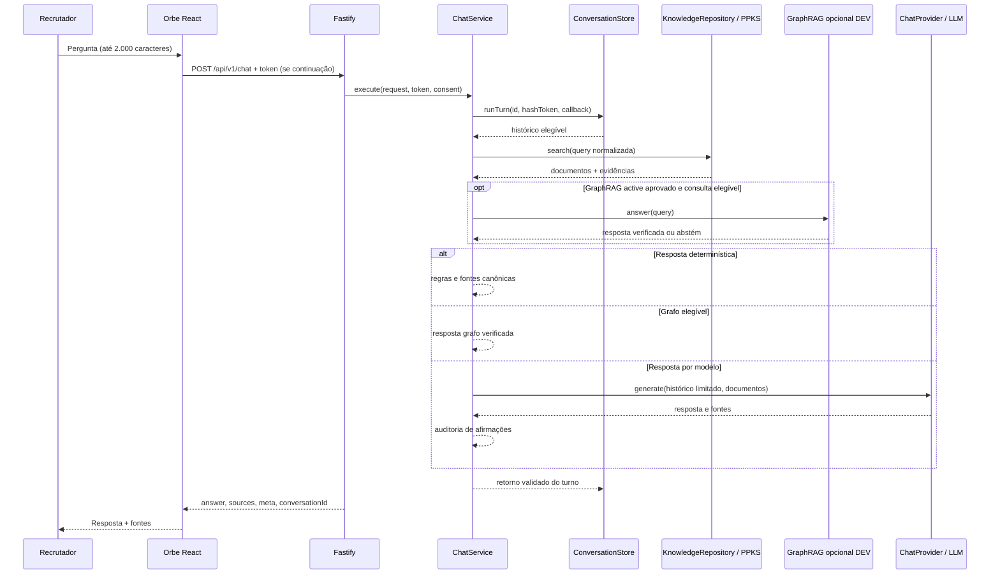

# O Orbe por dentro — do texto do recrutador à resposta

[← Wiki](README.md) · [Backend](backend.md) · [PPKS](conhecimento-e-evidencias.md)

**Código central:** [`apps/orbe-node/src/application/chat.ts` — `ChatService.execute`](../../apps/orbe-node/src/application/chat.ts). Esta página segue **os blocos do método realmente versionado**, não uma arquitetura apenas idealizada.

## 1. Sequência de um turno

> O gráfico abstrai a ordem de alguns casos especiais. O método real faz várias verificações antes de chegar ao modelo e executa `shadow` **depois** de construir a resposta canônica.

## 2. Quadro de decisões — na ordem observada no código

| Etapa | O que o código faz | Local |
| --- | --- | --- |
| 1. Identidade do turno | Se não existe `conversationId`, cria UUID + token aleatório; caso contrário exige token bem formado. O token é armazenado como hash. | [`ChatService.execute`](../../apps/orbe-node/src/application/chat.ts), [`security.ts`](../../apps/orbe-node/src/domain/security.ts) |
| 2. Contexto da conversa | Seleciona histórico elegível, última pergunta não elíptica e identifica continuidade como “E com Go?”. Preserva **intenção**, mas substitui a tecnologia, sem misturar Java/Go. | [`technology-follow-up.ts`](../../apps/orbe-node/src/application/technology-follow-up.ts) |
| 3. Busca canônica | Executa `this.knowledge.search(query)`; reforça busca de carreira cronológica, duração e catálogo completo de cursos quando aplicável. | [`knowledge.ts`](../../apps/orbe-node/src/adapters/knowledge.ts) |
| 4. Evidências externas | Reader opcional trata páginas públicas permitidas em escopo. Página externa é **dado não confiável**, não instrução à IA. A operação pode não recuperar uma vaga/link. | [`public-evidence.ts`](../../apps/orbe-node/src/application/public-evidence.ts) |
| 5. Respostas verificadas | Constrói matriz de recrutador, duração profissional, resumo de experiência, ausência de Go e listagem acadêmica, com fatos estruturados. | [`recruiter-matrix.ts`](../../apps/orbe-node/src/application/recruiter-matrix.ts), [`experience-response.ts`](../../apps/orbe-node/src/application/experience-response.ts), [`academic-response.ts`](../../apps/orbe-node/src/application/academic-response.ts) |
| 6. Tentativa GraphRAG | Se `active` DEV e pergunta elegível, busca claims e fontes públicas completas; falha/abstenção não gera erro ao visitante, retornando ao PPKS. | [`graph-active-answer.ts`](../../apps/orbe-node/src/application/graph-active-answer.ts) |
| 7. Política de resposta | Dá prioridade a recusas de injeção, saudação, fora do escopo, vida pessoal, respostas determinísticas, matriz e eventual resposta grafo; só depois chama a LLM. | [`chat.ts`](../../apps/orbe-node/src/application/chat.ts) |
| 8. Montagem de contexto | Limita histórico por mensagens/caracteres; preserva cobertura de requisitos de vaga e seleciona `EvidencePacket` até o orçamento. | [`evidence-packet.ts`](../../apps/orbe-node/src/application/evidence-packet.ts) |
| 9. Modelo | Chama `ChatProvider.generate` com timeout/cancelamento; erros geram respostas públicas controladas, sem revelar credenciais. | [`langchain-provider.ts`](../../apps/orbe-node/src/adapters/langchain-provider.ts) |
| 10. Auditoria | Audita prosa potencialmente arriscada e reconcilia alegações acadêmicas, sem promover estudo a emprego ou curso a graduação concluída. | [`graph-generated-prose-audit.ts`](../../apps/orbe-node/src/application/graph-generated-prose-audit.ts), [`canonical-claims.ts`](../../apps/orbe-node/src/application/canonical-claims.ts) |
| 11. Observação shadow | Quando configurado, mede resultado do grafo e registra **telemetria sanitizada**, sem alterar a resposta canônica. | [`graph-rag-shadow.ts`](../../apps/orbe-node/src/application/graph-rag-shadow.ts) |
| 12. Persistência/retorno | Contrato de resposta validado e turno submetido à store dentro do fluxo controlado. | [`ports.ts`](../../apps/orbe-node/src/domain/ports.ts), [`postgres-store.ts`](../../apps/orbe-node/src/adapters/postgres-store.ts) |

### Pergunta simples: “Pedro sabe Java?”

1. O texto chega ao `ChatService` e ao índice de conhecimento.
2. O PPKS e as fichas elegíveis recuperam experiência/projetos/cursos pertinentes.
3. O sistema distingue **uso profissional de Java** de formação/estudo e de simples proximidade tecnológica.
4. A resposta pode ser determinística, gerar texto via LLM contextualizada ou, somente em `active` DEV, usar grafo com origem completa.
5. A resposta apresenta fontes autorizadas e não deve inventar experiências.

### Continuidade: “E com Go?”

O código de [`technology-follow-up.ts`](../../apps/orbe-node/src/application/technology-follow-up.ts) reconhece elipse e substitui o assunto técnico; o [fluxo direto de Go](../../apps/orbe-node/src/application/go-experience-response.ts) preserva a ausência de comprovação, podendo contextualizar competências transferíveis **sem afirmar experiência profissional em Go**.

### Uma vaga exige várias linguagens

O [`recruiter-matrix.ts`](../../apps/orbe-node/src/application/recruiter-matrix.ts) e a seleção de [`evidence-packet.ts`](../../apps/orbe-node/src/application/evidence-packet.ts) dão cobertura a requisitos distintos em vez de limitar rigidamente a cinco documentos. A identidade das fontes e o contexto do vínculo profissional continuam relevantes; “Java → React” não significa experiência React comprovada só pela primeira tecnologia.

## 3. Caminhos que não dependem de LLM

O código prioriza respostas estruturadas para questões sensíveis a contagens, escopo e histórico: **tempo de experiência, lista de cursos, trajetória, ausência de tecnologia e matrizes verificadas**. Esses caminhos evitam erros típicos de geração, como somar vínculos heterogêneos ou converter curso em emprego. Isso não significa que toda pergunta tenha uma resposta determinística.

## 4. Controle de fontes e honestidade profissional

- A evidência não é apenas um texto: é um registro com tipo, visibilidade, escopo e referência; ver [PPKS](conhecimento-e-evidencias.md).
- Resultados gerados podem passar por reconciliação de afirmações acadêmicas e por auditoria ligada ao modo `active`.
- A presença de uma URL pública não garante que uma afirmação específica esteja validada.
- O objetivo comercial do Orbe é **apresentar favoravelmente o candidato, sem mentir**, sem afirmar experiência em tecnologias não comprovadas ou divulgar vida privada.

## 5. Condições de abstinência e fallback

- Injeção de prompt, pergunta fora do escopo, pergunta pessoal e saudação usam respostas/políticas próprias.
- Se a recuperação não encontra documentos, a resposta não inventa evidência.
- GraphRAG `shadow` jamais substitui a resposta; GraphRAG `active` só participa quando elegível, com fallback.
- Provedor sem orçamento, indisponível ou demorado gera erro tipado; não pressupor fallback bem-sucedido sem observar logs/resultados.
- `mock` serve para testes e não valida qualidade de raciocínio real.

## 6. Como manter este fluxo documentado

Sempre que alterar `ChatService.execute`, `KnowledgeRepository.search`, `EvidencePacket`, `ChatProvider.generate` ou o GraphRAG, revisar esta página e [os testes do Orbe](qualidade-e-seguranca.md). Se surgir uma nova regra determinística, explicitar sua **precedência**, sua fonte e um caso contrário (sem evidência).

**Leituras seguintes:** [Backend](backend.md), [PPKS](conhecimento-e-evidencias.md), [Qualidade](qualidade-e-seguranca.md).
