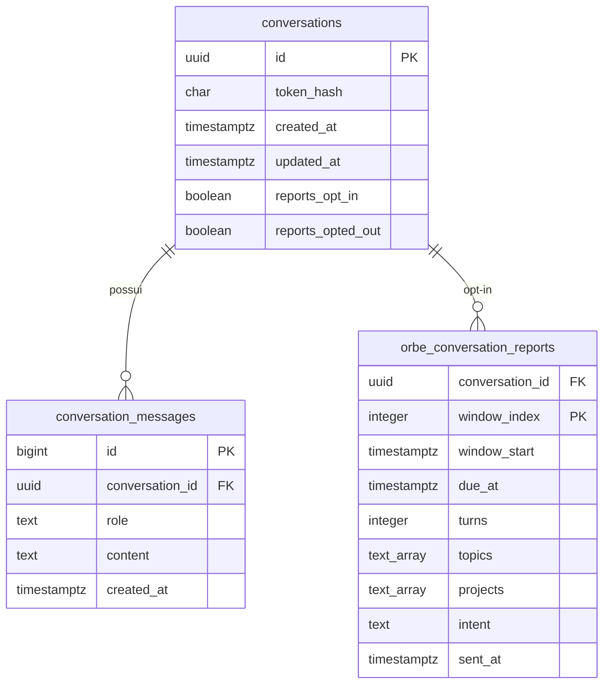

# Banco de dados — seis migrations e o motivo de cada uma

[← Wiki](../README.md) · [Persistência](../modulos/persistencia-e-relatorios.md) · [Gerenciador de migrations](../../../packages/database/src/migrations.ts)

**Fonte:** `infrastructure/postgres/migrations/`, backend `main` `c302ec444266`. Os arquivos foram lidos diretamente. **Esta revisão não executou SQL** ou verificou se algum servidor já aplicou as migrations.

| Migration                                                                                                              | Objetos principais                                                            | Estado funcional                                    |
| ---------------------------------------------------------------------------------------------------------------------- | ----------------------------------------------------------------------------- | --------------------------------------------------- |
| [001_conversations.sql](../../../infrastructure/postgres/migrations/001_conversations.sql)                             | `conversations`, `conversation_messages`, índices de retenção e histórico     | Orbe público                                        |
| [002_auth.sql](../../../infrastructure/postgres/migrations/002_auth.sql)                                               | `auth_users`, identidades OIDC, roles, transações OAuth, auditoria e sessões  | Código legado/condicional; não há login público     |
| [003_meetings.sql](../../../infrastructure/postgres/migrations/003_meetings.sql)                                       | propostas, reuniões, auditoria, outbox, índices e exclusão de períodos `gist` | Legado/condicional; não há reuniões públicas        |
| [004_notifications.sql](../../../infrastructure/postgres/migrations/004_notifications.sql)                             | `notification_deliveries`, status e índice para retry                         | Legado, vinculado ao `meeting_outbox`               |
| [005_calendar_create_uncertainty.sql](../../../infrastructure/postgres/migrations/005_calendar_create_uncertainty.sql) | flag `calendar_create_uncertain` e marcação de reservas sem ID externo        | Recuperação histórica de calendário, não chat atual |
| [006_orbe_reports.sql](../../../infrastructure/postgres/migrations/006_orbe_reports.sql)                               | flags de consentimento, `orbe_conversation_reports`, `orbe_daily_reports`     | Serviço opcional de relatórios, por opt-in          |

## Modelo lógico essencial do Orbe público

**Chave composta:** `orbe_conversation_reports` usa `(conversation_id, window_index)` como PK (não `window_index` isolado). O desenho acima é simplificado; consulte SQL para índices, constraints, locks e todas as colunas de claims/retry.

## Migração 001 — conversas

`conversations.token_hash` (char 64) guarda a impressão SHA-256 do token, e `conversation_messages` associa turnos com `ON DELETE CASCADE`. O `role` permite `user` ou `assistant`. A coluna de conteúdo tem `CHECK (char_length(content) BETWEEN 1 AND 8000)`; **isso é limite por mensagem armazenada, diferente do limite de 2.000 da pergunta pública**. Índices `conversations_retention_idx` e `conversation_messages_history_idx` ajudam retenção/histórico.

## Migração 002 — autenticação histórica

Autenticação Google OIDC criou entidades de usuário, identidades externas (`issuer,subject` únicos), roles e sessões. Não cria admin automaticamente. O comentário SQL declara que tokens Google e access JWT não são persistidos e os cookies opacos são registrados como hash. **Essas tabelas não significam login disponível na interface atual**.

## Migrações 003–005 — reuniões e recuperação histórica

A `003` usa `btree_gist` e `EXCLUDE USING gist` em intervalos reservados para evitar sobreposição, além de `meeting_outbox`. A `004` controla entrega de notificações e retries. A `005` registra a **incerteza** sobre criação de evento de calendário antes de haver confirmação de identidade externa — uma decisão de prevenção de duplicatas em workflows anteriores. Esses componentes não integram o runtime público atual.

## Migração 006 — relatórios consentidos

Adiciona a `conversations` `reports_opt_in` e `reports_opted_out`. Os relatórios por conversa guardam agregados: `window_start`, `turns`, `topics`, `projects`, `intent`, `sent_at`, contadores e locks de entrega. O arquivo diz expressamente: **não armazenar texto livre da conversa nas tabelas de analytics**. `orbe_daily_reports` agrega por `report_day`.

## Mecanismo `migrate(pool,directory)`

Fonte: [`packages/database/src/migrations.ts`](../../../packages/database/src/migrations.ts).

1. Obtém um cliente do pool e `pg_advisory_lock(81827419)` para serializar migrações.
2. Garante tabela `schema_migrations(name,checksum,applied_at)`.
3. Lista apenas `NNN_nome.sql` em ordem crescente, calcula SHA-256 do conteúdo.
4. Se migration já existe, compara checksum e **recusa alterações posteriores**.
5. Se é inédita, executa SQL + marcação dentro da mesma transação; falha faz `ROLLBACK`.
6. Libera o advisory lock e conexão em `finally`.

**Não editar migration já implantada.** Criar nova migration incremental após revisar compatibilidade DEV/MAIN, backup, locking, rollback e tempo de execução.

## Convenções de testes/manutenção

- [`tests/postgres.integration.test.ts`](../../../tests/postgres.integration.test.ts): contratos de persistência.
- [`tests/postgres-admission.test.ts`](../../../tests/postgres-admission.test.ts): limite de capacidade concorrente.
- [`tests/orbe-reports.test.ts`](../../../tests/orbe-reports.test.ts): consentimento e relatórios.
- [`tests/auth.integration.test.ts`](../../../tests/auth.integration.test.ts) e [`tests/meetings.integration.test.ts`](../../../tests/meetings.integration.test.ts): suporte a código legado, não prova de habilitação pública.

**Critério para homologar BD:** verificar migrations contra instância isolada, constraints/índices e resultado de testes; não reproduzir strings de conexão ou dados reais na wiki.
